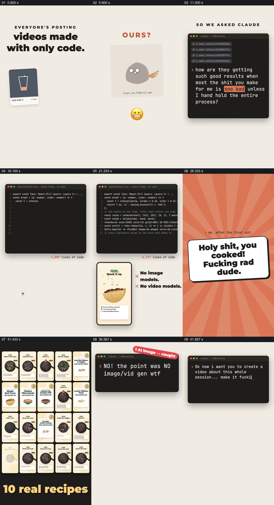

# 从作品落差发起请求，用代码、成果集合和自我回指讲完整制作过程

- 作品：案例 031《代码制作餐食图解的过程说明》（库内索引名称）。
- 原片范围：00:00.000–00:46.000，含起点、不含终点；[完整原片](../video.mp4)｜[本卡片段](c01.mp4)。
- 范围依据：从他人作品和自身结果对照，到大量食谱成果、纠错和当前影片的回指；随后为技术声明与收尾。
- 观察方式与未确认范围：查看整片 64 帧总览和本卡分镜。未独立完成连续原速观看与听审；抽帧之间的运动、停顿与声音配合待复核。画面中的界面、数字与说明是作品呈现，未经额外核实；设计价值为基于画面的分析。

## 原画面具体怎样设计

浅色竖屏上先有“大家都在发布只用代码做的视频”，下方依次出现饮料、彩条和柱状图形式的示例卡。随后橙色“OURS?”下面换成一张简陋小角色和尴尬表情；黑色终端窗口接着占据上方，列出参考链接与一段询问结果为何不佳的文字。

深色放射背景上的“Hold on. Let me cook.”把请求接到制作。回到浅色画面后，终端代码和行数位于上方，下面一部手机中依次显示锅、食材和餐食页面，旁边写没有图像及视频模型、只有代码。橙色放射背景的夸张反馈卡之后，多张小型食谱视频卡在黑底上排成密集矩阵，底部依次显示钩子、食谱和视频数量。

之后终端显示对一张 AI 图片的纠正，下方出现标注为重新用代码绘制的人物插图；最后另一条终端请求要求制作关于整个过程的视频，旁边手机中的画面出现片头的示例布局，形成影片讲述自己如何被要求制作的回扣。

## 为什么这样设计，好在哪里

开头不是抽象宣称能力，而是把参照作品与不满意结果并置，让后续终端请求有具体动机。代码窗口与手机产物上下相邻，使制作过程和视觉结果可同时被看到；矩阵把单份食谱扩展为可感知的规模，纠错片段则保留过程中的偏差。结尾回到相同片头，把正在观看的影片也纳入故事。

代码行数、模型使用方式和作品数量均为片中展示，本次未独立核实；静帧也不能证明真正的生成过程。

## 完整照排指令

以[完整原片](../video.mp4)的 0–46 秒为准。画幅 720×1280，源帧率 30/1。以下拍点为抽帧定位，位置按画幅百分比取近似值。

### 用料

【他人作品组】【自身初版】【终端提问】【制作记录】【食谱首集】【食谱成品组】【纠正指令】【纠正结果】【回指影片】按同一次创作轨迹备料。首集可在成果墙找回，自我回指应复用本片开场。另备【开场粗句】【落差问词】【转场应答】【制作边注】【反应引文】【成果计数词】【片尾结论】【片尾工具名】【片尾入口】。真实声明附可打开的产物、制作记录和数量口径，引用他人作品附授权和链接。

### 按源时刻摆放

1. **0–约 7 秒。** 竖身暖白底，顶部疏排小黑字，下方逐行出粗黑【开场粗句】。左上深蓝、右上浅白、中下深绿三张【他人作品组】错角入场，白边与阴影清楚。随后整体退，赭色小粗【落差问词】在顶端，中央只留较浅的【自身初版】，下面一枚表情点。可用静态图层，保留好坏对照所依据的实际作品。
2. **约 7–15 秒。** 浅底中央上部换窄深色终端，等宽【终端提问】逐字打出，问题关键短语用暖色底条聚焦。约 12 秒起切深黑放射纹，居中用白粗短句和暖黄大字逐步形成【转场应答】，下加小火形。终端退尽后才给放射强调。
3. **约 15–24 秒。** 回浅底。深终端在上部逐行增加【制作记录】，下方手机竖窗给【食谱首集】；窗右从小黑到赭红依次给【制作边注】。手机内以同一食谱连续推进，勿冻结来代替食材变化。随后橙红放射背景接走，白圆角纸上以粗黑【反应引文】居中，边缘小散点短留。
4. **约 24–34 秒。** 换暗放射底，白色转折句先占上部，黄锯齿爆框接一句。随后用【食谱成品组】铺满成窄缝竖卡阵列，近五列起、向下增加多排。图卡稳定后底部暖黄粗【成果计数词】按阶段换。已完成的卡片仍留在集合，海报缩图可以定格；动态格需保留相位，只有外围展示可循环，真实数量用独立说明。
5. **约 34–39 秒。** 回浅底，上置黑终端显示【纠正指令】，边角红签突出错误。下方浅绿边竖窗显示【纠正结果】，并补一行小绿说明。若比较前后，保留被纠正对象的同一场面和角色。
6. **约 39–46 秒。** 上方新终端用等宽小白字输入要制作本片的请求，下部手机窗出现【回指影片】，在小窗里重现开场字及三卡。手机从出现至暗尾接管持续播放，不能用其他影片代替回指。最后硬切深底，上部用大白【片尾结论】，中段【片尾工具名】较小，下方【片尾入口】接实际结果。按 46.000 秒切出。

### 局部采用

只有请求和首集可用约 7–24 秒。只有同源成果集合可取约 24–34 秒。纠正及自我回指须有对应证据，可单取约 34–46 秒。

### 验证状态

已对照逐秒原片画序并读回。核对三卡落差、终端与手机同在、成果墙累积、纠正版本与末段手机复用开场。精确切帧、终端原文、原速听看和换料待核。
