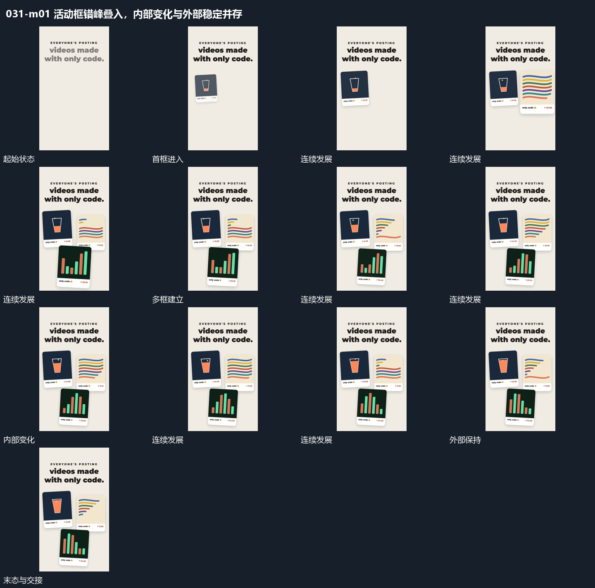

# 活动框错峰叠入，内部变化与外部稳定并存

## 运动指令

先接入首个活动框，再错开加入左右及下方框。各框落稳后，内部图形继续变化，上方标题与框的整体位置保持。多框展示结束后收成中部单框，下方补小标记，承接下一段。

## 视频切片

[播放本机制的原片切片](m01.mp4)

覆盖分镜中“首框进入”至“收成单框”的连续过程，并保留邻近的前后衔接画面；原片中交叠发生的动作一并保留。

## 分镜过程

## 组合与调整

框内可以放任意连续材料。保持外部稳定和内部活动的区分，不让所有层持续漂移。
