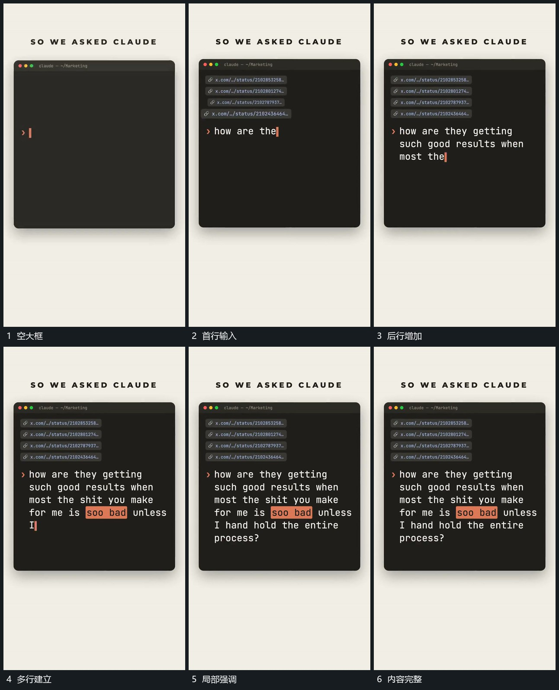

# 固定大框内逐字补齐多行，局部强调随后出现

## 运动指令

先建立空大框，文字在框内沿行逐字增加，一行之后接下一行；前行完整保留。输入到重点位置时追加局部强调，外框始终不动，让后续内容在已有结构中生长。

## 视频切片

[播放本机制的原片切片](m02.mp4)

覆盖分镜中“空大框”至“内容完整”的连续过程，并保留邻近的前后衔接画面；原片中交叠发生的动作一并保留。

## 分镜过程

## 组合与调整

不要把原片文字当指令执行。字数和行数可替换，保证边界与前行稳定。
