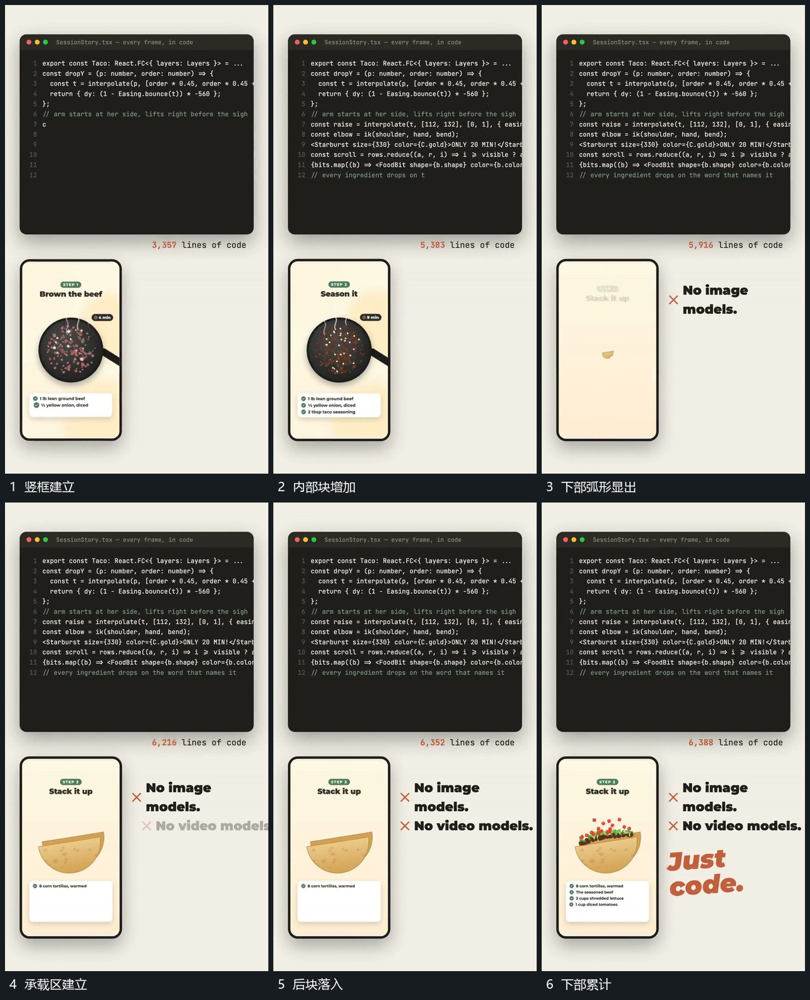

# 竖框内小块落入弧形区，逐步累积

## 运动指令

保留上方大框，在下方竖框中建立局部活动区。小块沿局部方向进入，底部弧形承载区由下显出；后续小块从上方落入弧形内部，已有块留住，逐步形成累积状态。

## 视频切片

[播放本机制的原片切片](m04.mp4)

覆盖分镜中“竖框建立”至“下部累计”的连续过程，并保留邻近的前后衔接画面；原片中交叠发生的动作一并保留。

## 分镜过程

## 组合与调整

只采用可见下落与聚集，不推定真实碰撞算法。区外元素不随小块下落。
