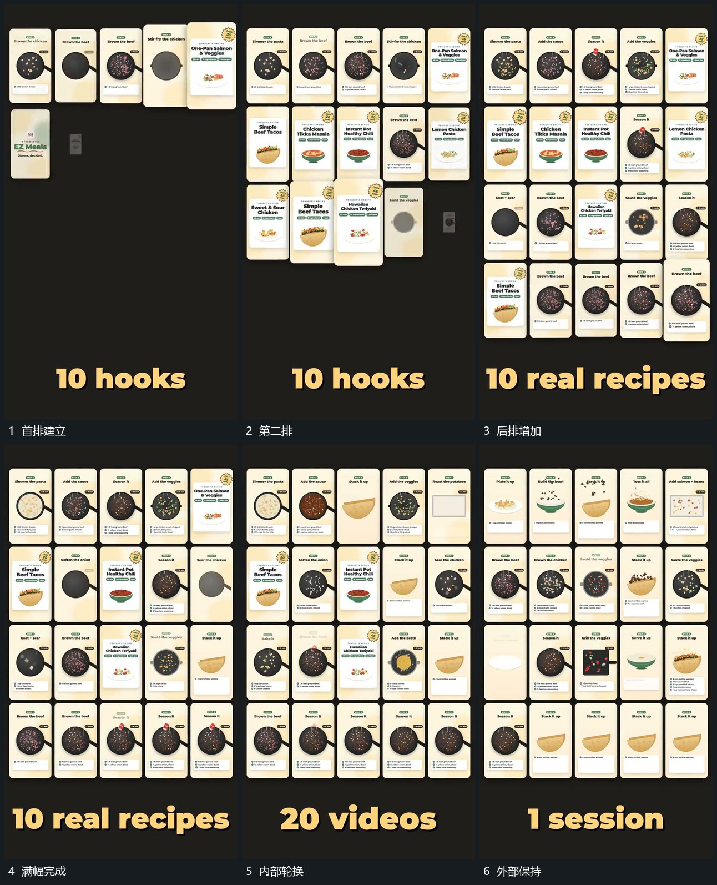

# 小框逐排填满，满幅后保持边界并持续轮换内部

## 运动指令

先建立一排小框，再依次补入下方各排，已建立的排保留。填满画面后，外部网格与间距保持，各框内部材料继续轮换或活动，下方字组另行更新。

## 视频切片

[播放本机制的原片切片](m06.mp4)

覆盖分镜中“首排建立”至“外部保持”的连续过程，并保留邻近的前后衔接画面；原片中交叠发生的动作一并保留。

## 分镜过程

## 组合与调整

可减少行列。满幅不是必须无限移动，区分填充阶段和内部持续阶段。
