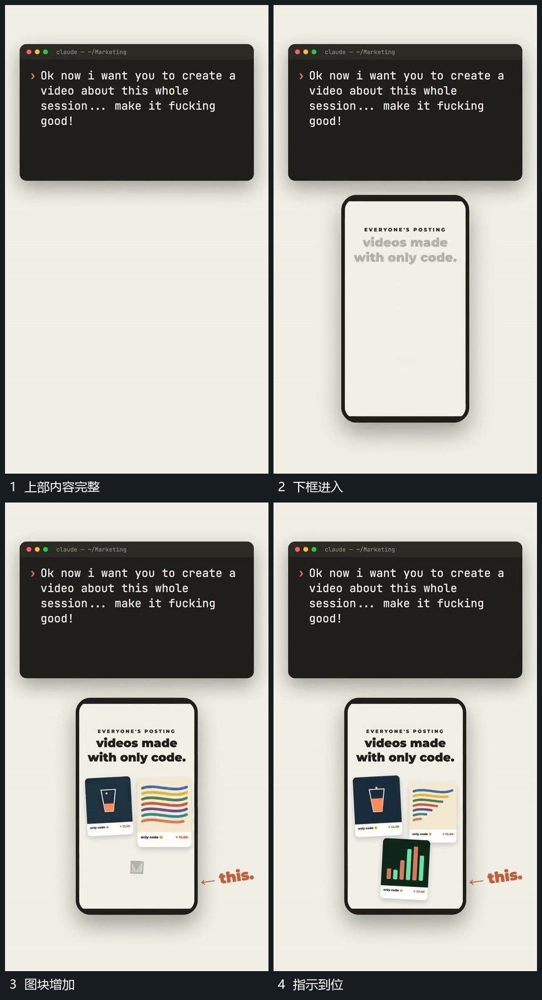

# 下部竖框接入，局部块补齐后指示箭头到位

## 运动指令

等上部输入完成，再从下方接入竖框。框内图块依次补齐，箭头在目标块已建立后指向该处；上方输入区全程保持，形成内容到示范区的接续。

## 视频切片

[播放本机制的原片切片](m07.mp4)

覆盖分镜中“上部内容完整”至“指示到位”的连续过程，并保留邻近的前后衔接画面；原片中交叠发生的动作一并保留。

## 分镜过程

## 组合与调整

指示位置必须跟随实际块，不能先指空位。图块数量可调整。
