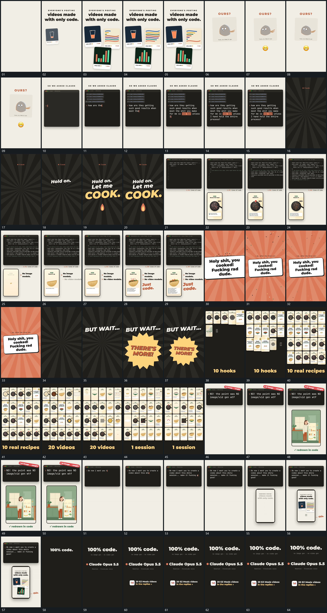

# 031｜原片运动总览

[观看完整原片](video.mp4)

## 运动总览

开头 活动框错峰叠入，内部变化与外部稳定并存 将多个活动框错开接入，框内继续变化，外部标题保持；随后收成单框。固定大框内逐字补齐多行，局部强调随后出现 在固定大框中逐字建立多行内容，局部强调随输入接续。后层放射展开，前景字组分行建立并放大接力 用后层放射线与前景字组的尺度变化接上下一段。

中段 竖框内小块落入弧形区，逐步累积 在下方竖框内让小块下落并累计到弧形承载区；之后 大倾斜片侧下入场，转正缩回后散片退落 让大倾斜片从侧下方进入，转正缩回，周边散片继续退落。小框逐排填满，满幅后保持边界并持续轮换内部 从一排到多排补齐小框，再让各排内部持续变化。后段重用 固定大框内逐字补齐多行，局部强调随后出现 输入多行，下部竖框接入，局部块补齐后指示箭头到位 追加下部竖框和局部指示；最终主字与底部短条建立并保持。

## 完整运动段落

以下按原片中的出现顺序引用。建立、内部发展及完成反馈放在同一段中；同时发生的局部动作与运镜写在同一份指令里。不同段之间可以是连续接管，也可以是直接切换，不能仅凭条目相邻认定可直接拼接。重复出现的同类运动采用一次连续代表范围，切片不以逐段无缝覆盖整片为目标。

1. [活动框错峰叠入，内部变化与外部稳定并存](mechanisms/m01.md)：框错峰进入，外部位置落稳

2. [固定大框内逐字补齐多行，局部强调随后出现](mechanisms/m02.md)：边界保持，输入沿行推进

3. [后层放射展开，前景字组分行建立并放大接力](mechanisms/m03.md)：后层先展开，字组分行接上

4. [竖框内小块落入弧形区，逐步累积](mechanisms/m04.md)：局部落入，边界与上层保持

5. [大倾斜片侧下入场，转正缩回后散片退落](mechanisms/m05.md)：大面先进入，散片随后继续

6. [小框逐排填满，满幅后保持边界并持续轮换内部](mechanisms/m06.md)：逐排增加，整体位置随后保持

7. [下部竖框接入，局部块补齐后指示箭头到位](mechanisms/m07.md)：下框先进入，内容随后补齐

切片保留起始准备、必要内部停顿和完成或明确交接；首尾省略无新发展的等待，持续运动不要求人为停住。以上基于真实源帧序列和重点边界核对，不等同于全片连续声画审片。

## 完整64宫格

