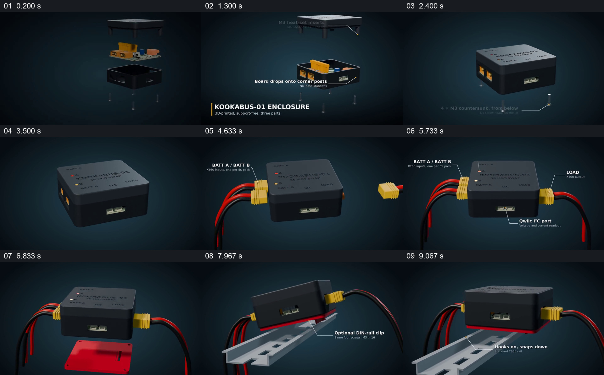

# 用同一装置串起组装、接线和安装

- 作品：案例 106《电子盒的组装与安装》（本次概括）。
- 原片范围：00:00.000–00:10.000，含起点、不含终点；[完整原片](../video.mp4)｜[本卡片段](../video.mp4)。
- 观察方式：依据约每秒一次的真实源帧观察，未连续原速观看或听审；声音、语气与完整播放节奏未确认。

## 原画面具体怎样设计

电路板位于盒体底座上，上盖与螺钉靠近并组成黑色盒子，旁边文字指向嵌件与固定位置；黄色接头和红黑线分别接到盒子两端，标签标识电池、负载、指示灯和接口。接着盒子下方出现红色夹具和导轨，装置倾斜靠近并落在导轨上。

## 为什么这样设计，好在哪里

同一盒子贯穿组装、接线和固定，标签把外观细节与用途位置对应；导轨场景让装置最终如何放置可见。连接与机械规格为图示，未验证。

以上为依据画面的分析，非作者自述；预期观看效果未经观众测试。

## 可直接使用的创意指令

展示装置组装时，用真实部件按顺序呈现外壳、电路、固定件和连接方式，给关键接口与方向标注；最后在实际安装位置展示装置如何固定。电气和机械参数须依据设计资料。
