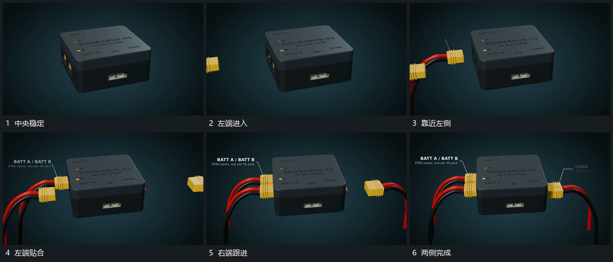

# 左右端块先后靠近插入，尾部线形跟随

## 运动指令

保持中央完整组，让左侧端块先从画外靠近对应边缘，逐渐插入并停住，尾部线形随端块向内移动。左侧建立后，右侧再重复靠近和贴合，中央组不为每个端块单独大幅转动。

## 视频切片

[播放本机制的原片切片](m02.mp4)

覆盖分镜中“中央稳定”至“两侧完成”的连续过程，并保留邻近的前后衔接画面；原片中交叠发生的动作一并保留。

## 分镜过程

## 组合与调整

可改变先后侧与端块数量，连接目标应在动作前可辨认。线形需要跟随端点变化，不能端块已经插入而尾线仍停在原位置。
