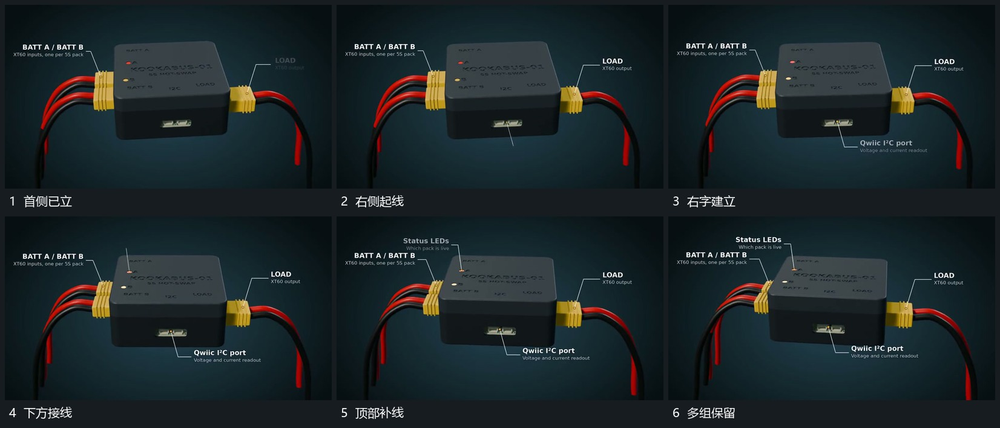

# 折线标注围绕稳定对象逐个展开

## 运动指令

在稳定组周围逐项建立折线标注：先侧边，再下部，再顶部。每条线的一端对应局部位置，向外折出到空位后接上文字；下一条建立时，前面的线和文字继续留场，不随新标注闪灭。

## 视频切片

[播放本机制的原片切片](m03.mp4)

覆盖分镜中“首侧已立”至“多组保留”的连续过程，并保留邻近的前后衔接画面；原片中交叠发生的动作一并保留。

## 分镜过程

## 组合与调整

可改变标注顺序，保留局部端点与说明区的对应。主体随后转动时标注可先退去，若继续保留则需要跟随端点，不能漂在旧位置。
