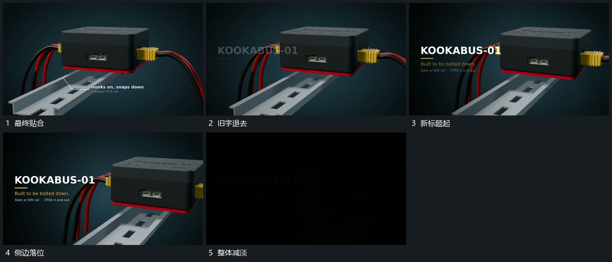

# 完整组向侧边让位，旁侧文字接入后减淡

## 运动指令

贴合完成后退出局部说明，让整组向一侧让位，新标题在另一侧建立，再补下方附属行。最终结构始终可见，文字完成后整体减淡结束，不再拆开已经合拢的层次。

## 视频切片

[播放本机制的原片切片](m05.mp4)

覆盖分镜中“最终贴合”至“整体减淡”的连续过程，并保留邻近的前后衔接画面；原片中交叠发生的动作一并保留。

## 分镜过程

## 组合与调整

可省略片尾减淡用于承接下一段，仍需保留最终结构的确认。文字区的位置由让位方向决定，不与连接线或长轨重叠。
