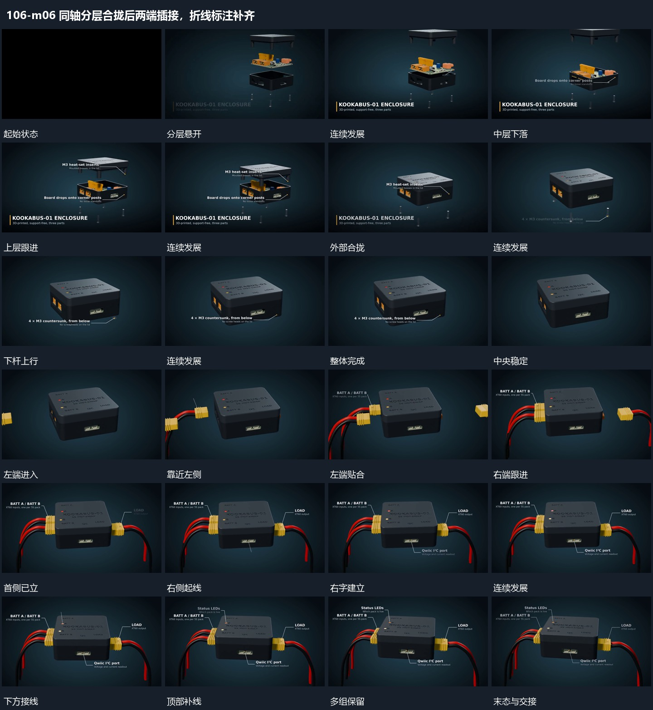

# 同轴分层合拢后两端插接，折线标注补齐

## 运动指令

同轴层逐项靠拢合成主组，末端短杆从反向补入；左右端块先后插接，尾线跟随，稳定后外围折线和短标逐项展开。

1. **同轴分层依次合拢，末端小杆反向补入**

先沿同一竖轴保留分开的层次，底层作为固定参照。让中层向下进入底层，再让上层跟着下降并覆盖中层；外部合拢后，底部细小杆件向上移动补入，完成整组。各层按空间关系接力，已归位的层不随下一层重启。

2. **左右端块先后靠近插入，尾部线形跟随**

保持中央完整组，让左侧端块先从画外靠近对应边缘，逐渐插入并停住，尾部线形随端块向内移动。左侧建立后，右侧再重复靠近和贴合，中央组不为每个端块单独大幅转动。

3. **折线标注围绕稳定对象逐个展开**

在稳定组周围逐项建立折线标注：先侧边，再下部，再顶部。每条线的一端对应局部位置，向外折出到空位后接上文字；下一条建立时，前面的线和文字继续留场，不随新标注闪灭。

整段结束：多条折线分别连接不同局部，先出现的线与文字保持。 保留必要落稳与交接，中间已建立的参照沿用到下一步骤。

## 视频切片

[播放本机制的原片切片](m06.mp4)

保留起始准备、连续发展和完成或明确交接；首尾按本段运动范围裁切，不拼接、不变速。相连的小动作合为同一完整段落。

## 分镜过程

## 组合与调整

同轴层逐项靠拢合成主组，末端短杆从反向补入；左右端块先后插接，尾线跟随，稳定后外围折线和短标逐项展开。 复用时可调整元素数量、幅度和相对节奏，保留上述进入、交叠与完成关系；不直接沿用原片题材或时长。

可改变层数与间距，保持先后遮挡及共同轴线。不要把每层同时压在一起，否则无法看清归位关系。后续外侧连接从完整组继续。

可改变先后侧与端块数量，连接目标应在动作前可辨认。线形需要跟随端点变化，不能端块已经插入而尾线仍停在原位置。

可改变标注顺序，保留局部端点与说明区的对应。主体随后转动时标注可先退去，若继续保留则需要跟随端点，不能漂在旧位置。
