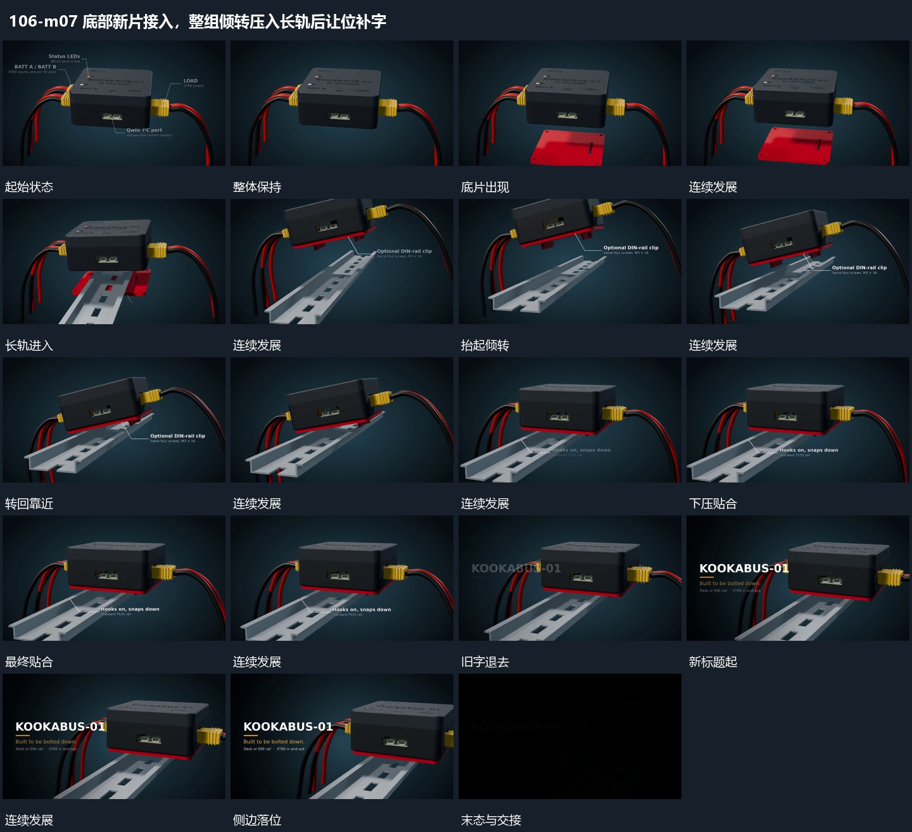

# 底部新片接入，整组倾转压入长轨后让位补字

## 运动指令

底部新片接住完整主组，整体抬起并倾转对准长轨，向下贴合；完成后整体侧移让出空区，旁字接入并逐渐退弱。

1. **下方新片接入，整组抬起倾转后下压贴合长轨**

先退去上一组标注，让下方新片进入，中央整组抬起并倾转，为底片和斜向长轨让出空间。底片靠近下表面，长轨从下方斜入；整组随后转回、向轨靠近，再下压贴合。两侧已经连接的线形随整个组的位置改变，不能留在画面旧坐标。

2. **完整组向侧边让位，旁侧文字接入后减淡**

贴合完成后退出局部说明，让整组向一侧让位，新标题在另一侧建立，再补下方附属行。最终结构始终可见，文字完成后整体减淡结束，不再拆开已经合拢的层次。

整段结束：完整组靠一侧，另一侧字组建立，随后整体减淡。 保留必要落稳与交接，中间已建立的参照沿用到下一步骤。

## 视频切片

[播放本机制的原片切片](m07.mp4)

保留起始准备、连续发展和完成或明确交接；首尾按本段运动范围裁切，不拼接、不变速。相连的小动作合为同一完整段落。

## 分镜过程

## 组合与调整

底部新片接住完整主组，整体抬起并倾转对准长轨，向下贴合；完成后整体侧移让出空区，旁字接入并逐渐退弱。 复用时可调整元素数量、幅度和相对节奏，保留上述进入、交叠与完成关系；不直接沿用原片题材或时长。

可调整倾角和进入方向，保留抬起让位、对齐、落下的顺序。源帧支持可见贴合，不足以推断内部机械约束或真实受力。

可省略片尾减淡用于承接下一段，仍需保留最终结构的确认。文字区的位置由让位方向决定，不与连接线或长轨重叠。
