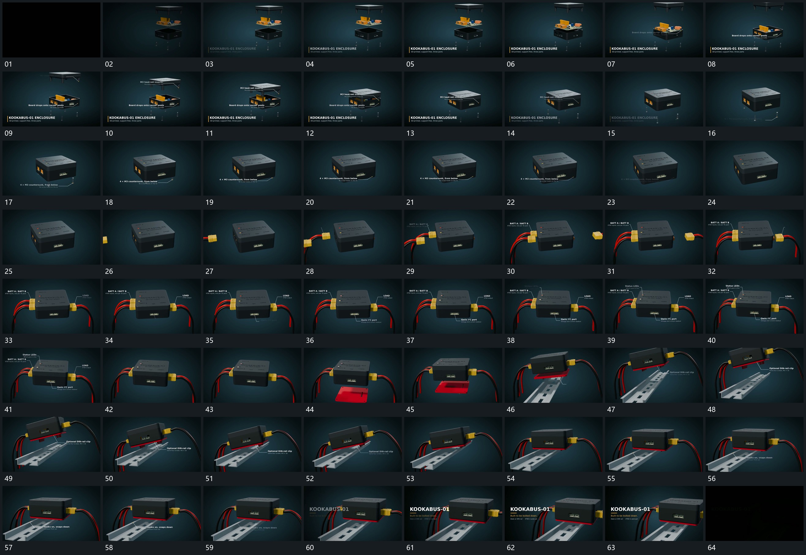

# 106｜原片运动总览

[观看完整原片](video.mp4)

## 运动总览

开头显出沿竖向分开的层次与下方字组。同轴分层依次合拢，末端小杆反向补入 让中层、上层依次向下合拢，底部小杆再反向向上补齐；局部说明随归位阶段出现。

整组稳定后 左右端块先后靠近插入，尾部线形跟随 从左侧、右侧先后接入端块，尾部线形跟随。随后 折线标注围绕稳定对象逐个展开 沿侧面、下方、顶部逐项建立折线标注，已出现部分保留。

标注退去，下方新片接入，整组抬起倾转后下压贴合长轨 让下方新片与长轨进入，整组抬起倾转、回转靠近，最后下压贴合。已经连接的线形跟随整组移动。尾部 完整组向侧边让位，旁侧文字接入后减淡 将完整结构让到一侧，另一侧字组接入，最后整体减淡。

## 完整运动段落

以下按原片中的出现顺序引用。建立、内部发展及完成反馈放在同一段中；同时发生的局部动作与运镜写在同一份指令里。不同段之间可以是连续接管，也可以是直接切换，不能仅凭条目相邻认定可直接拼接。重复出现的同类运动采用一次连续代表范围，切片不以逐段无缝覆盖整片为目标。

1. [同轴分层合拢后两端插接，折线标注补齐](mechanisms/m06.md)：同轴层逐项靠拢合成主组，末端短杆从反向补入；左右端块先后插接，尾线跟随，稳定后外围折线和短标逐项展开。

2. [底部新片接入，整组倾转压入长轨后让位补字](mechanisms/m07.md)：底部新片接住完整主组，整体抬起并倾转对准长轨，向下贴合；完成后整体侧移让出空区，旁字接入并逐渐退弱。

切片保留起始准备、必要内部停顿和完成或明确交接；首尾省略无新发展的等待，持续运动不要求人为停住。以上基于真实源帧序列和重点边界核对，不等同于全片连续声画审片。

## 完整64宫格

