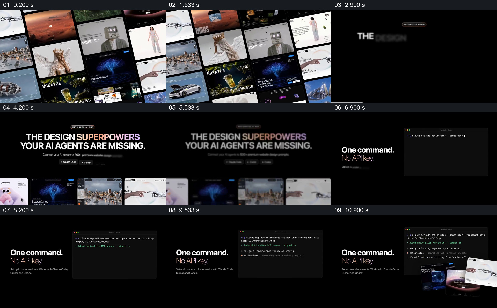

# 先以作品墙展示能力，再把它接到一次终端操作

- 作品：案例 022《网页影像墙与空间展示》（库内索引名称）。
- 原片范围：00:00.000–00:12.000，含起点、不含终点；[完整原片](../video.mp4)｜[本卡片段](c01.mp4)。
- 范围依据：从完整作品集合建立，至命令、搜索结果与三个页面示例出现。
- 观察方式与未确认范围：查看整片 64 帧总览和本卡分镜。未独立完成连续原速观看与听审；抽帧之间的运动、停顿与声音配合待复核。画面中的界面、数字与说明是作品呈现，未经额外核实；设计价值为基于画面的分析。

## 原画面具体怎样设计

开场黑色背景上，多张大小相近的网站页面倾斜排布，汽车、人物、城市和抽象图像各自在小窗口中；整个集合占据画面，大量页面边缘被画框裁切，呈现墙面延伸感。

画面转为黑底居中的宣传主张，底部保留一排网站缩略图；随后主张退出，左侧出现“One command. No API key.”，右侧是深色终端窗口。命令、成功提示及一条建站要求先后出现在窗口内，最后页面实例以小卡形式从终端右下方露出，既保留操作过程又可看到画面结果。

## 为什么这样设计，好在哪里

作品墙先让观众看见能力所指向的具体页面，而不是只得到一句抽象能力承诺。切到终端时，页面让出主要阅读空间；结果小卡再出现，使命令与实际视觉成果重新发生联系。

画面中的接入、搜索与建站均属于产品演示，不能仅凭动画证明系统真实完成操作。

## 完整照排指令

以[完整原片](../video.mp4)的 0–12 秒为准。画幅 1280×720，源帧率 30/1。以下拍点为抽帧定位，位置按画幅百分比取近似值。

### 用料

【作品组】备多份可公开页面或短动图，至少一份与【终端命令】的【终端结果】对应。【主张】【操作标题】【操作副句】【品牌标识】用短文。实际功能附可打开的命令文档和对应结果，不展示密钥。

### 按源时刻摆放

1. **0–约 3 秒。** 黑底上以窄黑缝拼满【作品组】，多列横窗斜向铺过四边。保留远近和明暗差，整墙滑移后压暗。装饰窗可用静帧或平稳循环，关键结果用同一连续段。
2. **约 3–6 秒。** 黑底上部用居中两行粗白【主张】，关键词可用弱渐变。下方把旧作品缩成一排小横窗，持续至标题退场；勿换成无关项目。
3. **约 6–10 秒。** 左侧白粗【操作标题】及低亮【操作副句】，右侧近黑宽矩形。顶端等宽小字输入【终端命令】，下方逐行补【终端结果】，末拍右下短入同一结果预览。保留命令直到结果成立。
4. **约 10–12 秒。** 终端全退，纯黑中央用彩色符号与白字拼【品牌标识】，按 12.000 秒切出。

### 局部采用

只有作品可用 0–约 6 秒；有可核对命令和结果可用约 6–10 秒。

### 验证状态

已对照逐秒画序并读回，核对斜墙、标题下缩图及终端输出累积。精确切帧与换料待核。
