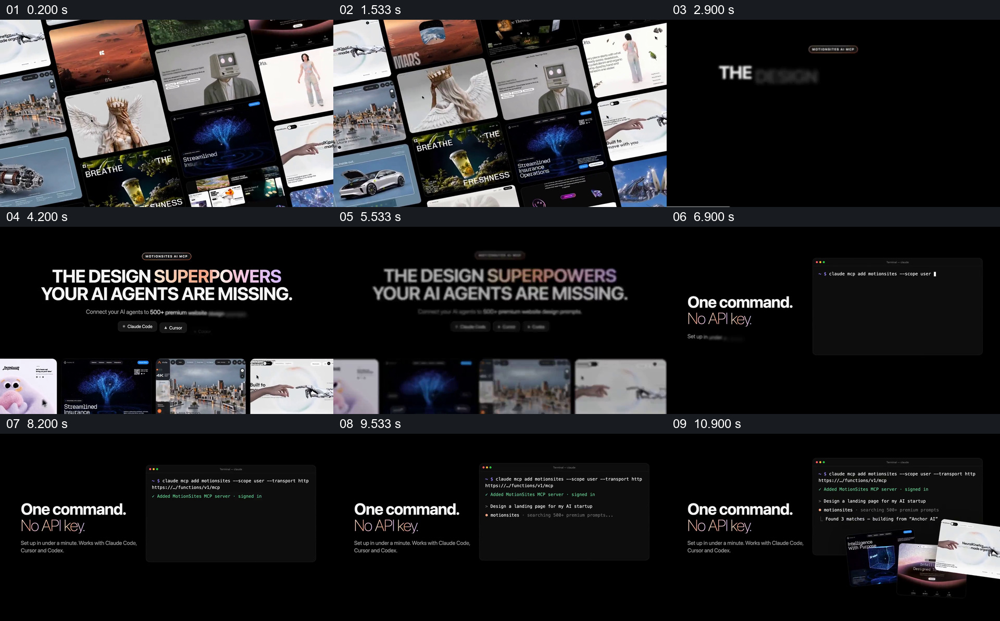

# 从作品墙转到命令行和页面结果

- 作品：案例 022《网站作品墙与里程碑》（索引名称）。
- 原片范围：00:00.000–00:12.000，含起点、不含终点；[完整原片](../video.mp4)｜[本卡片段](c01.mp4)。
- 观察方式：依据整片 64 宫格和约每秒一次的真实源帧观察，未连续原速观看或听审；声音、语气与完整播放节奏未确认。

## 原画面具体怎样设计

一组倾斜的网页作品图片铺满画面；黑底标题写“THE DESIGN SUPERPOWERS YOUR AI AGENTS ARE MISSING”，底部保留几张作品缩略图。随后左侧显示“One command. No API key.”，右侧终端出现命令及输出，几张网页示例叠放在窗口前方。

## 为什么这样设计，好在哪里

作品墙先给出可见的样例范围，再把抽象功能缩到一次命令与旁边的界面结果，观众能够把工具主张和视觉材料联系起来。画面仅为演示，不能证明命令、服务及页面生成效果。

以上为依据画面的分析，非作者自述；预期观看效果未经观众测试。

## 可直接使用的创意指令

当介绍一项连接素材库和工作工具的能力时，先选取有授权的代表样例，让观众看到素材的差异；再展示真实的入口、必要输入和可核对的输出，保留一两个样例与操作界面同屏。实际命令和服务条件应按可运行版本核实，演示画面应标明。
