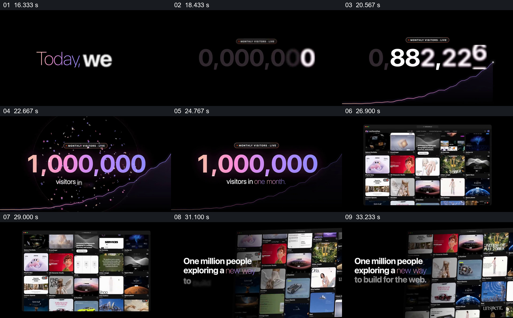

# 让一个访问量结果扩展回具体作品集合

- 作品：案例 022《网页影像墙与空间展示》（库内索引名称）。
- 原片范围：00:16.000–00:35.000，含起点、不含终点；[完整原片](../video.mp4)｜[本卡片段](c02.mp4)。
- 范围依据：从“Today”开始建立时间和结果，到网站作品墙及百万人参与的短句完成。
- 观察方式与未确认范围：查看整片 64 帧总览和本卡分镜。未独立完成连续原速观看与听审；抽帧之间的运动、停顿与声音配合待复核。画面中的界面、数字与说明是作品呈现，未经额外核实；设计价值为基于画面的分析。

## 原画面具体怎样设计

黑底中央出现“Today, we hit”，之后是标有 MONTHLY VISITORS 的大数字与底部上升曲线。数字从不同数值变化到彩色的 1,000,000，周围出现彩屑，下面补出“visitors in one month”；曲线仍从下方延伸到右侧，结果和发展轨迹同框。

数字退出后，屏幕出现一个深色网站浏览窗口，内部是多行页面缩略图；随后窗口扩展为画面右侧的倾斜作品墙，左侧短句写“One million people exploring a new way to build for the web”。从抽象数量回到具体作品，观众可以同时看到结果与其所属产品的内容。

## 为什么这样设计，好在哪里

数字先独占画面，让里程碑一眼可辨；曲线把结果放在变化过程里，彩屑强调数字到达的状态。之后并不只停留在数字，而把页面库重新展现出来，使数量与具体内容建立视觉关系。

数字、曲线和月访问量是原片主张，本次没有独立统计依据。

## 完整照排指令

以[完整原片](../video.mp4)的 16–35 秒为准。画幅 1280×720，源帧率 30/1。以下拍点为抽帧定位，位置按画幅百分比取近似值。

### 用料

【里程碑首句】【访问终值】【访问单位】【累计曲线】来自同一数据定义和截止时点，备可打开的统计出处、单位与时间范围。若曲线是示意，明确注明。【作品库】【作品缩图组】取与里程碑关联且可展示的项目，并备【用户短句】【邻段字样】。保留对应项目的链接或作品存档。

### 按源时刻摆放

1. **16.000–约 18.000 秒。** 近黑底中央建【里程碑首句】，前半细字带浅紫渐变，后半白色略粗；暗蓝矩形纹理在后短留。
2. **约 18.000–25.000 秒。** 中心换超大【访问终值】计数，白粗等高数字各列滚动。起初前导位低亮，随后依次变白。下半由左低至右高绘细紫【累计曲线】，读数推进时曲线右侧继续延伸。到终值用暖粉至蓝紫渐变，数字下留更小的【访问单位】，少量彩屑短闪。曲线和读数同场停留，终值与统计一致，滚动值仅作动画。
3. **约 25.000–29.500 秒。** 数字整层退，居中抬入深色【作品库】窗，白、暖橙、紫、青的【作品缩图组】以窄暗缝多列排列。窗体保持小黑边与整体比例，再略向右扩。缩图作为静态内容可微移；动态预览从各窗出现到移交连续播放，只有气氛格可平稳循环。
4. **约 29.500–35.000 秒。** 【作品库】留于右侧，左边逐行长出白粗【用户短句】，补行略灰，小幅扩入黑底。末拍右侧墙面拆成几块远近不同的暗缩图，中央进入薄字【邻段字样】，按 35.000 秒切出。

### 局部采用

只有可靠数据可采用约 16–25 秒；只有具体作品和用户说明可用约 25–33 秒，避免补入无依据的里程碑。

### 验证状态

已对照逐秒原片画序并读回，核对计数与紫线、终值停稳后作品窗接管、左字累积时右窗保留。精确切帧、数字过程和换料试摆待核。
