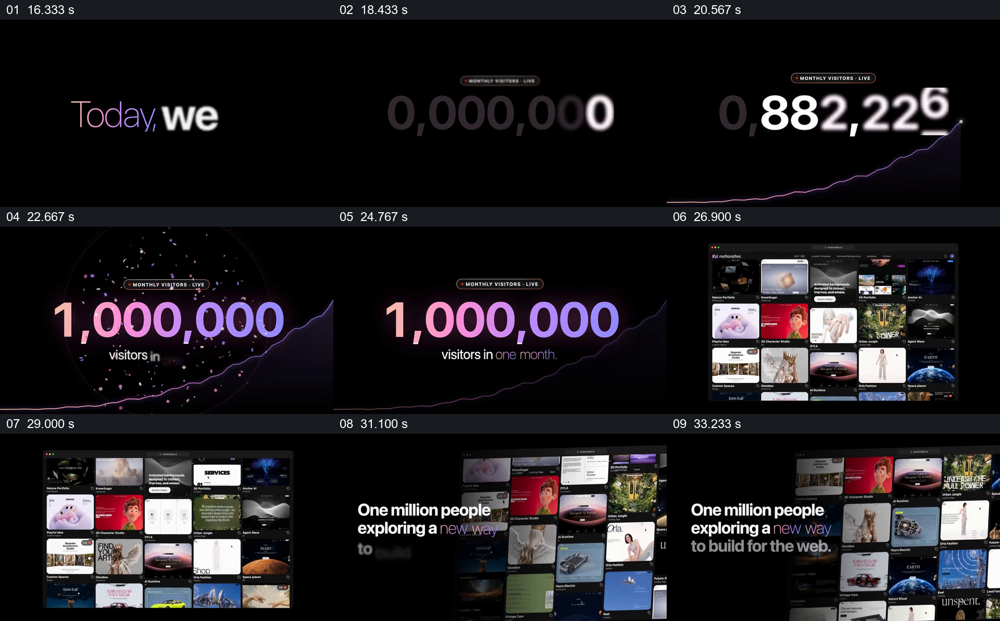

# 让一个访问量结果扩展回具体作品集合

- 作品：案例 022《网页影像墙与空间展示》（库内索引名称）。
- 原片范围：00:16.000–00:35.000，含起点、不含终点；[完整原片](../video.mp4)｜[本卡片段](c02.mp4)。
- 范围依据：从“Today”开始建立时间和结果，到网站作品墙及百万人参与的短句完成。
- 观察方式与未确认范围：查看整片 64 帧总览和本卡分镜。未独立完成连续原速观看与听审；抽帧之间的运动、停顿与声音配合待复核。画面中的界面、数字与说明是作品呈现，未经额外核实；设计价值为基于画面的分析。

## 原画面具体怎样设计

黑底中央出现“Today, we hit”，之后是标有 MONTHLY VISITORS 的大数字与底部上升曲线。数字从不同数值变化到彩色的 1,000,000，周围出现彩屑，下面补出“visitors in one month”；曲线仍从下方延伸到右侧，结果和发展轨迹同框。

数字退出后，屏幕出现一个深色网站浏览窗口，内部是多行页面缩略图；随后窗口扩展为画面右侧的倾斜作品墙，左侧短句写“One million people exploring a new way to build for the web”。从抽象数量回到具体作品，观众可以同时看到结果与其所属产品的内容。

## 为什么这样设计，好在哪里

数字先独占画面，让里程碑一眼可辨；曲线把结果放在变化过程里，彩屑强调数字到达的状态。之后并不只停留在数字，而把页面库重新展现出来，使数量与具体内容建立视觉关系。

数字、曲线和月访问量是原片主张，本次没有独立统计依据。

## 可直接使用的创意指令

报告有来源的里程碑时，先明确指标、对象和统计周期，让最终数字与变化轨迹能够同时辨认；若有相应的产品或成果材料，随后转到它们的具体集合，并用一句准确说明把数字与集合相连。

数量、图形、庆祝方式和窗口样式可调整；必须保留统计对象与作品之间的对应，不用装饰曲线代替真实数据。

本方法尚未在新题材中实测。
