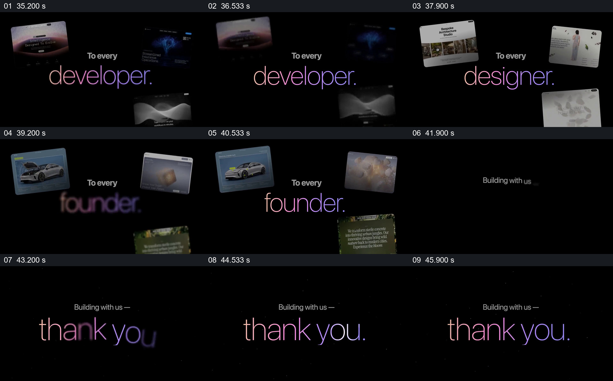

# 用不同作品回应不同参与者，最后收成一句感谢

- 作品：案例 022《网页影像墙与空间展示》（库内索引名称）。
- 原片范围：00:35.000–00:47.000，含起点、不含终点；[完整原片](../video.mp4)｜[本卡片段](c03.mp4)。
- 范围依据：从开发者称呼及实例开始，依次过渡到设计师、创始人和感谢文字。
- 观察方式与未确认范围：查看整片 64 帧总览和本卡分镜。未独立完成连续原速观看与听审；抽帧之间的运动、停顿与声音配合待复核。画面中的界面、数字与说明是作品呈现，未经额外核实；设计价值为基于画面的分析。

## 原画面具体怎样设计

黑底中央写“To every developer”，外围散开几张深色网站页面；接着中心称呼换成“designer”，周围改为建筑和人物等浅色页面；再换为“founder”，外围出现汽车、产品和植物主题页面。中心词使用细字渐变，实例保持在其周边，各组页面没有挤占文字中心。

不同角色展示完成后，外围页面退出，黑底只留较小的“Building with us—”和更大的渐变“thank you.”；文字完整显现后保持，随后进入品牌结尾。

## 为什么这样设计，好在哪里

同样位置的称呼提供可预测的阅读顺序，外围页面则让不同群体各有可见的作品参照。最后主动移走页面，只留感谢文字，注意力从比较实例集中到面向所有人的一句话。

角色与页面的具体归属关系在片中是视觉示意，不能据此认定真实作者或用户身份。

## 可直接使用的创意指令

向多个群体表达感谢时，为每组准备确有关系的代表性工作或素材；把群体名称放在稳定的中心区域，让示例围绕但不遮挡名称。各组展示后收起辅助素材，以一条清楚的共同感谢作为结果。

人数、排序、字体、页面形状都可重设；应确保示例与对应群体有依据，不为凑类别虚构参与者。

本方法尚未在新题材中实测。
