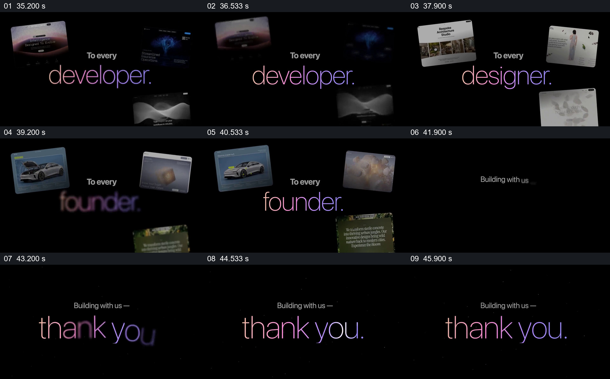

# 用不同作品回应不同参与者，最后收成一句感谢

- 作品：案例 022《网页影像墙与空间展示》（库内索引名称）。
- 原片范围：00:35.000–00:47.000，含起点、不含终点；[完整原片](../video.mp4)｜[本卡片段](c03.mp4)。
- 范围依据：从开发者称呼及实例开始，依次过渡到设计师、创始人和感谢文字。
- 观察方式与未确认范围：查看整片 64 帧总览和本卡分镜。未独立完成连续原速观看与听审；抽帧之间的运动、停顿与声音配合待复核。画面中的界面、数字与说明是作品呈现，未经额外核实；设计价值为基于画面的分析。

## 原画面具体怎样设计

黑底中央写“To every developer”，外围散开几张深色网站页面；接着中心称呼换成“designer”，周围改为建筑和人物等浅色页面；再换为“founder”，外围出现汽车、产品和植物主题页面。中心词使用细字渐变，实例保持在其周边，各组页面没有挤占文字中心。

不同角色展示完成后，外围页面退出，黑底只留较小的“Building with us—”和更大的渐变“thank you.”；文字完整显现后保持，随后进入品牌结尾。

## 为什么这样设计，好在哪里

同样位置的称呼提供可预测的阅读顺序，外围页面则让不同群体各有可见的作品参照。最后主动移走页面，只留感谢文字，注意力从比较实例集中到面向所有人的一句话。

角色与页面的具体归属关系在片中是视觉示意，不能据此认定真实作者或用户身份。

## 完整照排指令

以[完整原片](../video.mp4)的 35–47 秒为准。画幅 1280×720，源帧率 30/1。以下拍点为抽帧定位，位置按画幅百分比取近似值。

### 用料

【参与者称呼组】备三类真实参与者，【对应作品组】为各类备两三张可展示横图，所指关系应有项目署名或来源。备【称呼眉字】【感谢眉字】【感谢主句】【品牌标识】【里程碑小字】。实际里程碑复用上卡同口径数据与出处。

### 按源时刻摆放

1. **35.000–约 37.000 秒。** 黑底中央小白【称呼眉字】，下面大号极细无衬线【参与者称呼组】第一项，以暖粉至冷紫弱渐变。外围放其【对应作品组】，左上、右上和右下分散，略带透视倾角，绕开字。
2. **约 37.000–41.000 秒。** 中央按原位换第二、三类。外围作品随各类更新，保持二至三块斜漂小窗，黑缝与留白不变。图从各类出场保留到下一称呼接管；静照可漂移，动态用同属该类的连续段，外围气氛卡允许无缝循环。
3. **约 41.000–44.000 秒。** 外围卡全退，黑底先留中轴小白【感谢眉字】，再用细渐变大字【感谢主句】。组内文字不压缩为同一级，留黑至下一拍。
4. **约 44.000–47.000 秒。** 感谢句离开，中间小彩符号与白字合为【品牌标识】。零散点光横过中心高度，底下以小浅紫白字【里程碑小字】落稳。按 47.000 秒切出。

### 局部采用

有两组对应作品时可采用约 35–39 秒的两类致谢，再接约 41–44 秒感谢版。只有一句真实感谢，可独立采用该结尾。

### 验证状态

已对照逐秒原片画序并读回，核对三类换词及同拍换图、外围退尽后感谢、点光与品牌。精确切帧、各窗动态和换料待核。
