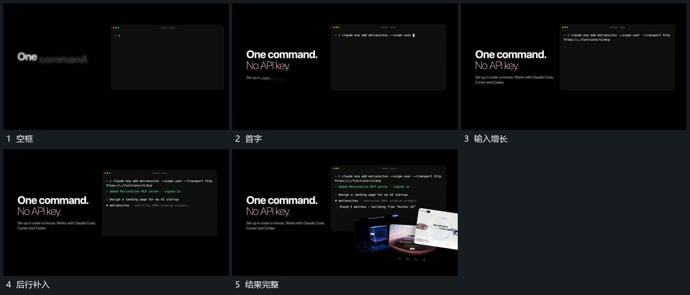

# 固定框内逐字输入，后行接续补齐

## 运动指令

在固定框内从首行逐字输入，已有字符留住，完成一行再接后行。旁侧文字保持，末段小片可以叠到框前，但不遮掉所有输入。

## 视频切片

[播放本机制的原片切片](m02.mp4)

覆盖分镜中“空框”至“结果完整”的连续过程，并保留邻近的前后衔接画面；原片中交叠发生的动作一并保留。

## 分镜过程

## 组合与调整

新片可缩短输入，保留累积而非整段闪现。
