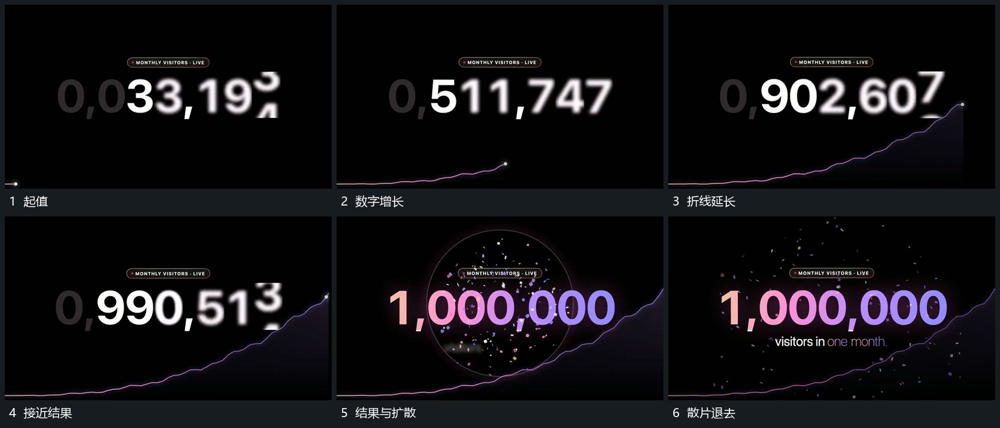

# 数字逐位滚动到结果，折线增长后小片扩散

## 运动指令

让数字逐位滚动增长，下方折线从左向右延长。临近最终值时减速停稳，再从中央扩出散片和外圈，反馈逐渐退去，结果留下。

## 视频切片

[播放本机制的原片切片](m03.mp4)

覆盖分镜中“起值”至“散片退去”的连续过程，并保留邻近的前后衔接画面；原片中交叠发生的动作一并保留。

## 分镜过程

## 组合与调整

真实数据另核；别在计数尚未完成时先给完成反馈。
