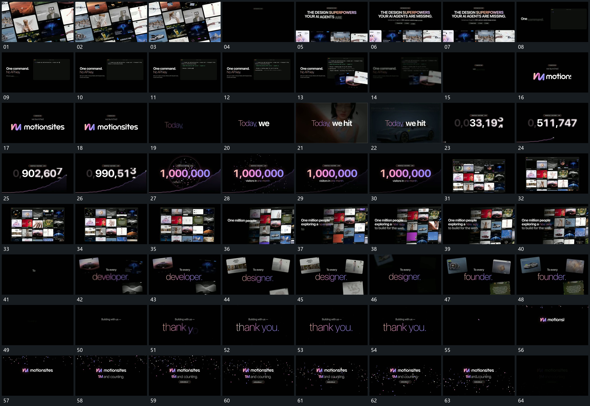

# 022｜原片运动总览

[观看完整原片](video.mp4)

## 运动总览

开头 倾斜多排集合流动后向下退让，中心字接上 让多排倾斜图块横向流动，集合退到下方后中心字组建立。固定框内逐字输入，后行接续补齐 保留局部框边，逐字输入，再逐行补入后续文字，几张小片在框前接入。

中段文字逐项建立，活动底层切换后退去，数字逐位滚动到结果，折线增长后小片扩散 中央数字逐位滚动增长，下方折线延长，到结果时散片从中心扩出。随后回到满幅集合，流动集合退弱，前景文字与少量片轮换 让集合横移退弱，前方文字保持；之后只留少量外围片，中心词组继续轮换。

收尾先建立中心短句，中心字稳定，周围散片向外扩出再下落 从周边散出小片，标记与附属行稳定，小片下落退出后整组减淡。

## 完整运动段落

以下按原片中的出现顺序引用。建立、内部发展及完成反馈放在同一段中；同时发生的局部动作与运镜写在同一份指令里。不同段之间可以是连续接管，也可以是直接切换，不能仅凭条目相邻认定可直接拼接。重复出现的同类运动采用一次连续代表范围，切片不以逐段无缝覆盖整片为目标。

1. [倾斜多排集合流动后向下退让，中心字接上](mechanisms/m01.md)：底层保持集合身份，退让后留中央空位

2. [固定框内逐字输入，后行接续补齐](mechanisms/m02.md)：旧字符和边界留住，后行继续加入

3. [数字逐位滚动到结果，折线增长后小片扩散](mechanisms/m03.md)：数字和路径并行，反馈只在终点出现

4. [流动集合退弱，前景文字与少量片轮换](mechanisms/m04.md)：集合运动继续，前字独立稳定，后段缩减外围

5. [中心字稳定，周围散片向外扩出再下落](mechanisms/m05.md)：反馈独立散开，中心组不漂移

切片保留起始准备、必要内部停顿和完成或明确交接；首尾省略无新发展的等待，持续运动不要求人为停住。以上基于真实源帧序列和重点边界核对，不等同于全片连续声画审片。

## 完整64宫格

