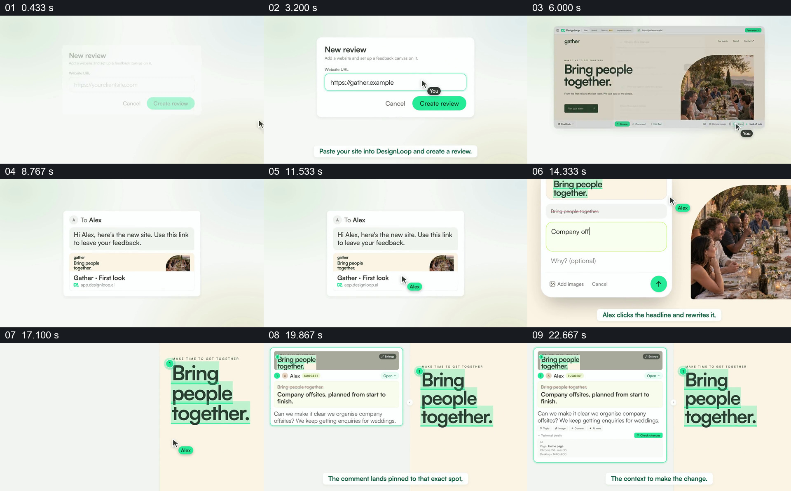

# 从链接进入网页，把一条修改意见固定到原位置

- 作品：案例 019《人物照片与页面重排》（库内索引名）。
- 原片范围：00:00.000–00:25.000，含起点、不含终点；[完整原片](../video.mp4)｜[本卡片段](c01.mp4)，片段起点对应原片 0.000 秒。
- 范围依据：从链接、原页面到附着于具体标题的意见，完成一次反馈建立。
- 观察方式：核看全片 64 帧总览及本卡九宫格；未独立连续原速观看，快速变化和运动节奏待核。未独立听审，声音内容未知。片中事实和演示未独立查证，新题材迁移尚未实测。

## 原画面具体怎样设计

浅色背景中央先出现“New review”输入框，网址填写后，带“Bring people together”标题的网页在右侧打开；分享窗口与发给 Alex 的链接卡随后出现。进入网页后，原标题被绿色标出，旁边的输入面板显示原文、新文案和理由；提交后页面仍在右侧，左侧意见卡保留标题截图、建议文字、理由与状态。

## 为什么这样设计，好在哪里

从分享入口到页面再到被选中的标题，观众可以追踪评论指向的具体对象；最终意见卡与原位置并排，避免把修改要求与网页脱离。颜色标注并不表示真实修改已经发生，画面只是产品流程演示。

## 完整照排指令

以[完整原片](../video.mp4)的 0–25 秒为准。画幅 1280×720，源帧率 30/1。以下拍点为抽帧定位，位置按画幅百分比取近似值。

### 用料

【目标网页】【网页原题】【网页主图】【待审网址】【分享预览】【选区截图】【建议原文】须取同一网页版本。准备【创建窗口标题】【创建按钮】【分享消息】【提交状态】【讲解短句组】。真实意见采用授权原文并附页上对象及可核对记录；真实链接在镜头内仅显示可公开部分。

### 按源时刻摆放

1. **0.000–约 4.000 秒。** 奶白至浅绿渐变铺底。中央白色小窗排黑粗【创建窗口标题】，其下灰细说明与单行【待审网址】，右下亮绿色胶囊【创建按钮】，左边留取消小字。暗点指针先进入框，在原位填地址，再移至确认钮。画中底部居中小黑【讲解短句组】随动作更新。
2. **约 4.000–11.500 秒。** 确认后给近满宽【目标网页】，内部暖白底，左侧黑粗多行【网页原题】，右侧上部圆弧裁切的【网页主图】。接着网页统一压暗，白分享窗在其前居中，保留能识别原页的两侧。分享链接进入【分享消息】或【分享预览】，以白色小卡置中，卡内的小主图和 URL 继续指回原页。只改变操作层，勿在过渡时把页面换成不同版本。
3. **约 11.500–18.500 秒。** 回到原页的较近裁切，左侧原题与右侧主图同框。绿色高亮按原题三行的行宽逐次贴入，指针靠近对应字而非照片。左边白浮签先放同名【网页原题】局部缩略，其下逐字呈【建议原文】，右下绿色圆钮留提交。浮卡覆盖部分旧网页但不要挡住右图，页面保持同一字号和位置直到进入下一布局。
4. **约 18.500–25.000 秒。** 将原页可见范围收成右侧选区，保留原题、绿色行底、标记点。左侧白色意见卡从头部及【选区截图】开始建立，逐行添【建议原文】和【提交状态】，淡绿细边框收口。意见与选区稳定并列到切出。所有界面可用同源静态截屏分层，选择框跟网页对象，提交动画只执行一次。按 25.000 秒切出。

### 局部采用

有同版网页和定位反馈可用约 11.500–25 秒。只介绍创建和分享可取 0–约 11.500 秒，在回到选区前切。

### 验证状态

已对照每秒两帧原片画序并读回，核对录网址、网页压暗时白分享窗居前、绿色贴住原题及意见与选区留在同画面。精确切点、原速听看和换料试摆待核。
