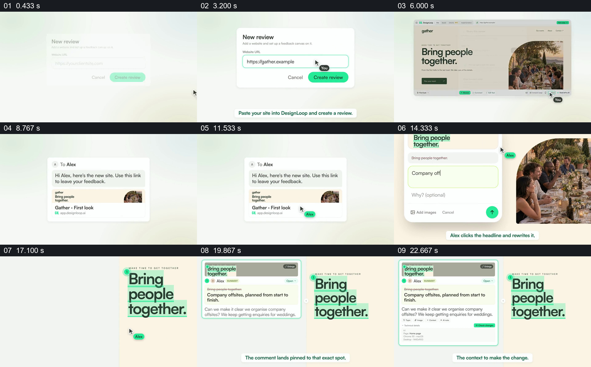

# 从分享网页到将具体反馈钉在原位置

- 作品：案例 019《人物照片与页面重排》（索引名称）。
- 原片范围：00:00.000–00:25.000，含起点、不含终点；[完整原片](../video.mp4)｜[本卡片段](c01.mp4)。
- 观察方式：依据整片 64 宫格和约每秒一次的真实源帧观察，未连续原速观看或听审；声音、语气与完整播放节奏未确认。

## 原画面具体怎样设计

浅色背景上先出现新建审阅的输入框和网址，点击后展示带人物照片的网页；分享弹窗接到发给 Alex 的消息。网页标题“Bring people together.”被绿色突出，旁边出现填写建议的面板。随后批注卡与原标题并列，卡里可见截图与修改文字，标题仍保留绿色标记。

## 为什么这样设计，好在哪里

先看到被讨论的页面，再把反馈附在具体标题上，随后将截图、建议和原位置放在同一视野里，使修改者知道反馈指向哪里。消息与界面是作品中的示例，不证明任何实际客户或产品行为。

以上为依据画面的分析，非作者自述；预期观看效果未经观众测试。

## 可直接使用的创意指令

当反馈必须准确指向某一页面元素时，先展示被审阅的真实页面和发送给接收者的入口；让接收者选中具体标题、图片或区域并填写建议，再把该建议、原内容与位置标识一起呈现。涉及真实参与者和页面时须有授权；界面形式可改，但原位置与反馈之间的关系应保持可追溯。
