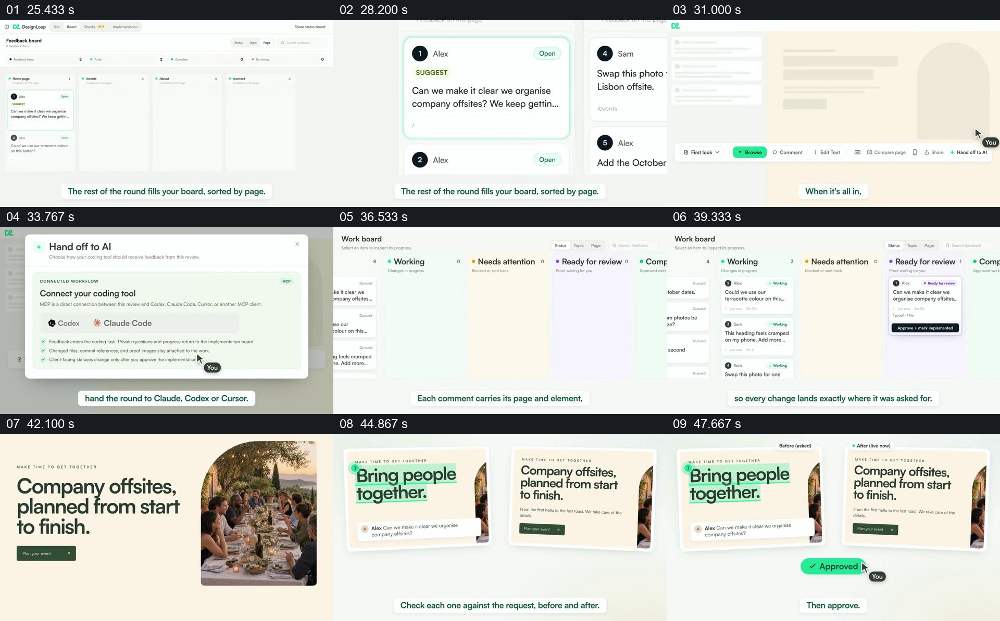

# 让意见进入工作看板，再用前后网页并排完成回查

- 作品：案例 019《人物照片与页面重排》（库内索引名）。
- 原片范围：00:25.000–00:50.000，含起点、不含终点；[完整原片](../video.mp4)｜[本卡片段](c02.mp4)，片段起点对应原片 25.000 秒。
- 范围依据：意见看板、交接、网页结果与前后核对共同形成完整反馈闭环。
- 观察方式：核看全片 64 帧总览及本卡九宫格；未独立连续原速观看，快速变化和运动节奏待核。未独立听审，声音内容未知。片中事实和演示未独立查证，新题材迁移尚未实测。

## 原画面具体怎样设计

页面意见交到按页面分列的反馈看板，单张卡片被放大；之后出现“Hand off to AI”窗口和工作看板，卡片在 Working 与 Ready for review 等列中可见。画面返回同一网页，标题由“Bring people together”换为“Company offsites, planned from start to finish.”；随后旧版含原意见与新版并排，底部出现批准状态。

## 为什么这样设计，好在哪里

看板使多个意见的处理状态可见，而返回同一网页和并排前后稿，让最初要求与结果可以直接比较。若只给一个“完成”状态而不回到被修改的位置，观众难以判断具体变化。画面不能证明这些工具在实际项目中真的完成了修改。

## 完整照排指令

以[完整原片](../video.mp4)的 25–50 秒为准。画幅 1280×720，源帧率 30/1。以下拍点为抽帧定位，位置按画幅百分比取近似值。

### 用料

【意见组】【目标意见】【评审板】【交接窗口】【工作看板】【修改前网页】【修改后网页】须来自同一项目。两个网页用相同画区裁切，保留同一主图，以标题变化形成直接对照。【意见原文】【交接按钮】【状态列名】【修改前标题】【修改后标题】【批准状态】【讲解短句组】按真实的前后状态填写。若为实际工作，附原意见、处理回执和网页版本入口，演示版用明示的虚构条目。

### 按源时刻摆放

1. **25.000–约 31.500 秒。** 画幅以灰绿暖白作基底，【评审板】近满宽占画中上部，横列细页面标题与灰边白卡。意见逐列补齐。随后推近【目标意见】，较大白卡偏左，头像和小名在顶部，正文【意见原文】用深灰两三行，右半仍见其他意见作旁证。讲解小字【讲解短句组】始终在画底近中轴，随步骤更新。推进时目标卡由原列移到主阅读层。
2. **约 31.500–36.500 秒。** 切至意见所指的网页或列表片刻，再压暗底层，居中放暖白【交接窗口】，占画宽约八成。高对比标题及较小字段在左，上段或中段给轻绿选项，行底设【交接按钮】。指针依次点选交接方式，操作发生时窗口一直留着，背景不可替成另一项目。静态截图可分层，暗层、窗口与指针分别控制。
3. **约 36.500–42.000 秒。** 模态窗退，满幅【工作看板】用数列浅面分组，顶部带【状态列名】，各列颜色轻分。带头像的【目标意见】在列中可辨，数次状态更新后右侧可出现小暗浮条。原列表、列名和其他意见保留；移动的是同一张任务卡，不另造一张无关的修改结果。
4. **约 42.000–45.500 秒。** 回到【修改后网页】的近览，暖米白底、右边拱裁照片，左侧【修改后标题】换行成大黑字。青绿选区贴文字而不吞掉字形。随后缩小页面，为左右双窗比较留位置。
5. **约 45.500–50.000 秒。** 两张白网页卡并排、等宽、等高。左为【修改前网页】与【修改前标题】，右为【修改后网页】和【修改后标题】。尽量使拱图位置、边距及主体比例对齐。下方小黑【讲解短句组】与小绿【批准状态】依次出现。两窗从入场留到旧版或整组退出，静态截图允许不动；如果包含动态主图，两窗应同时使用同一帧或同源连续播放，避免时间差变成额外变量。按 50.000 秒切出。

### 局部采用

仅有可追溯的同版前后页可取约 42–50 秒。只有回收与交接记录可取 25–约 42 秒，结束在修改后网页出现前。

### 验证状态

已对照逐秒原片画序并读回，核对意见列推进至白卡、交接弹层、任务看板与同位网页对照。精确切帧、状态小字、原速听看和换料试摆待核。
