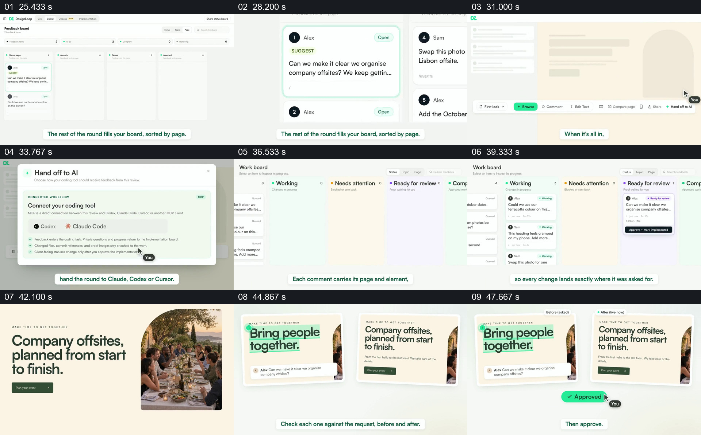

# 让意见进入工作看板，再用前后网页并排完成回查

- 作品：案例 019《人物照片与页面重排》（库内索引名）。
- 原片范围：00:25.000–00:50.000，含起点、不含终点；[完整原片](../video.mp4)｜[本卡片段](c02.mp4)，片段起点对应原片 25.000 秒。
- 范围依据：意见看板、交接、网页结果与前后核对共同形成完整反馈闭环。
- 观察方式：核看全片 64 帧总览及本卡九宫格；未独立连续原速观看，快速变化和运动节奏待核。未独立听审，声音内容未知。片中事实和演示未独立查证，新题材迁移尚未实测。

## 原画面具体怎样设计

页面意见交到按页面分列的反馈看板，单张卡片被放大；之后出现“Hand off to AI”窗口和工作看板，卡片在 Working 与 Ready for review 等列中可见。画面返回同一网页，标题由“Bring people together”换为“Company offsites, planned from start to finish.”；随后旧版含原意见与新版并排，底部出现批准状态。

## 为什么这样设计，好在哪里

看板使多个意见的处理状态可见，而返回同一网页和并排前后稿，让最初要求与结果可以直接比较。若只给一个“完成”状态而不回到被修改的位置，观众难以判断具体变化。画面不能证明这些工具在实际项目中真的完成了修改。

## 可直接使用的创意指令

从真实收集的意见建立工作项，保留其页面和对象信息，展示与当前任务相关的处理状态；完成后回到同一对象，将原要求、修改前和修改后置于可比较的位置，再依据实际结果确认。工具、看板列和视觉样式可变；保留意见来源、处理对象与结果的追踪关系。
