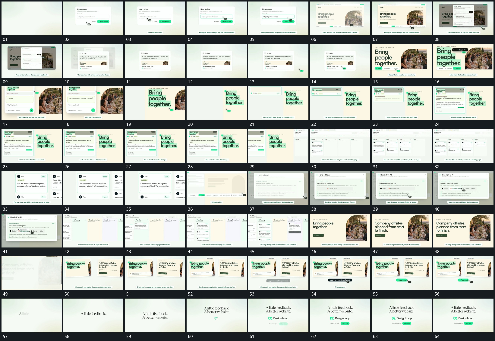

# 019｜原片运动总览

[观看完整原片](video.mp4)

## 运动总览

开头固定窗口内输入，指示符移动到末端后主框接入。后层退弱，前方浮窗建立后收回 让后层退弱、前方浮窗出现，更新后收回；新卡片接入并保留。接着 局部字组被框住，侧片推出后逐字补入 对局部字组建立范围强调，再向侧方推出编辑片。

中段 定位点留在原处，旁卡分层增长 从原位置建立定位点，旁侧浮卡由简到繁增长，保留原图与文字。之后 小卡分列填入，部分项在列间移动 将多个小卡填入分列布局，再在列间移动、留下新状态。局部浮窗反复接入时复用第一机制。

后段返回原框、更新局部文字，再 主框收为并置小片，前后状态分别留住 收成并置小片供对照，前后片保持不同内部状态，底部确认形接上。最后中心短句逐词建立，标记和长条补齐。

## 完整运动段落

以下按原片中的出现顺序引用。建立、内部发展及完成反馈放在同一段中；同时发生的局部动作与运镜写在同一份指令里。不同段之间可以是连续接管，也可以是直接切换，不能仅凭条目相邻认定可直接拼接。重复出现的同类运动采用一次连续代表范围，切片不以逐段无缝覆盖整片为目标。

1. [后层退弱，前方浮窗建立后收回](mechanisms/m01.md)：底层留场，浮窗负责短暂重点

2. [局部字组被框住，侧片推出后逐字补入](mechanisms/m02.md)：先定位范围，再在旁侧展开输入层

3. [定位点留在原处，旁卡分层增长](mechanisms/m03.md)：点提供锚点，旁卡内容按层补入

4. [小卡分列填入，部分项在列间移动](mechanisms/m04.md)：列作为固定容器，卡片独立变化

5. [主框收为并置小片，前后状态分别留住](mechanisms/m05.md)：收小保留内容，相邻片承载另一状态

切片保留起始准备、必要内部停顿和完成或明确交接；首尾省略无新发展的等待，持续运动不要求人为停住。以上基于真实源帧序列和重点边界核对，不等同于全片连续声画审片。

## 完整64宫格

