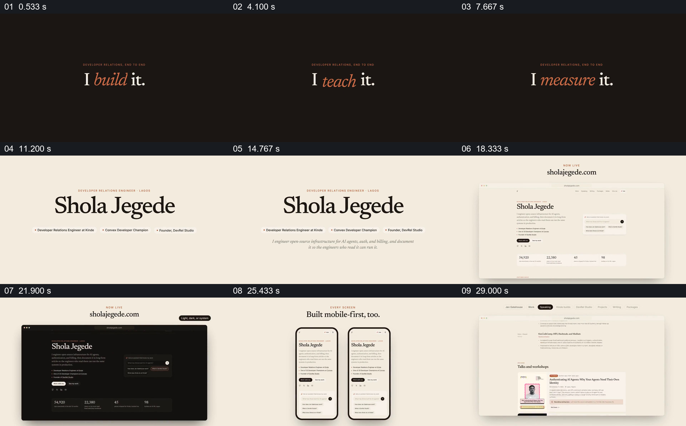

# 先用一组工作动词建立身份，再把人名接到桌面与手机网站

- 作品：案例 034《网页、手机与作品履历》（库内索引名称）。
- 原片范围：00:00.000–00:32.000，含起点、不含终点；[完整原片](../video.mp4)｜[本卡片段](c01.mp4)。
- 范围依据：从工作动词及身份建立，到网站明暗、移动端和内容入口；之后进入独立问答演示。
- 观察方式与未确认范围：查看整片 64 帧总览和本卡分镜。未独立完成连续原速观看与听审；抽帧之间的运动、停顿与声音配合待复核。画面中的界面、数字与说明是作品呈现，未经额外核实；设计价值为基于画面的分析。

## 原画面具体怎样设计

黑色背景中央保持“I ... it.”句式，橙色斜体动词依次显示 build、explain、teach、measure；上方有很小的工作范围说明。背景换为米白后，大号姓名居中，下面增加三条职务标签与一行简介。

姓名随后出现在浏览器窗口里的个人网站首页，顶部给出网址。相同首页先后以浅色和深色呈现，导航、个人简介、提问框和指标仍可辨认；接着两部手机并列显示窄屏页面，再回到桌面窗口展示演讲及项目等页面入口。大标题、身份说明与实际界面的版面都沿用黑、米白和少量橙色。

## 为什么这样设计，好在哪里

固定句式先让观众理解工作涵盖哪些动作，姓名和职务随后回答“是谁”，网站则提供可进一步查看的具体入口。深浅模式和移动端不是另起一套信息：相同名字与内容跨容器保留，使视觉变化服务于对同一网站的认识。

角色、网址和界面为作品中的展示，本次未核实其当前状态；手机页面也不能仅凭视频确认实际可交互。

## 可直接使用的创意指令

用三到四个确有依据的动词概括一个人或团队的工作，再明确姓名、身份和一句具体职责。将这些信息放进真实可查看的作品主页，展示一至两种必要的设备或显示状态，再让观众看见通往项目、文章或活动的入口。

黑白配色、排版和设备样式均可调整；保留工作范围、人物身份和实际作品之间的连接，不用视觉切换替代内容证据。

本方法尚未在新题材中实测。
