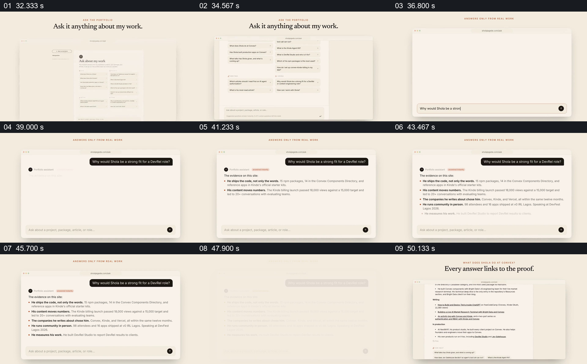

# 从可选问题走到具体回答，再回到可追溯来源

- 作品：案例 034《网页、手机与作品履历》（库内索引名称）。
- 原片范围：00:32.000–00:52.000，含起点、不含终点；[完整原片](../video.mp4)｜[本卡片段](c02.mp4)。
- 范围依据：从作品问答入口和问题列表，至回答与来源列表；52 秒后转向具体工作成果。
- 观察方式与未确认范围：查看整片 64 帧总览和本卡分镜。未独立完成连续原速观看与听审；抽帧之间的运动、停顿与声音配合待复核。画面中的界面、数字与说明是作品呈现，未经额外核实；设计价值为基于画面的分析。

## 原画面具体怎样设计

浅色背景顶部写“Ask it anything about my work”，浏览器内列出按主题分组的建议问题。页面随后换成更大的输入区，一条关于人物是否适合开发者关系岗位的问题出现在右上黑色气泡。

下方回答以橙色圆点逐条累积，每条先用粗体概括，再用项目、内容数据、社群活动和工作衡量等细节支持；提问气泡保持可见，回答均围绕同一个问题。结尾标题写“Every answer links to the proof”，画面显示有下划线的文章、项目及相关资料列表。

## 为什么这样设计，好在哪里

问题列表先限定观众可探索的范围；具体问题固定在上方，回答逐条出现时不容易失去语境。粗体判断与后面的具体证据并置，再把观看引到来源页面，形成从问题到结论再到可核查材料的层级。

片中声称回答来自真实工作，但本次只观察画面，未点击链接或核实内容，也不能确认生成回答的真实机制。

## 可直接使用的创意指令

准备一组与真实资料相对应的高价值问题，选一条完整展示提问与回答；将每个结论紧邻其证据摘要，并提供可以实际打开的原始项目、文章或记录。展示来源时保留问题及其上下文，避免只展示一串难以判断用途的链接。

问答界面可以是真实搜索、访谈或报告，视觉形式可变；必须区分演示和实际回答，来源与数字应在发布前验证。

本方法尚未在新题材中实测。
