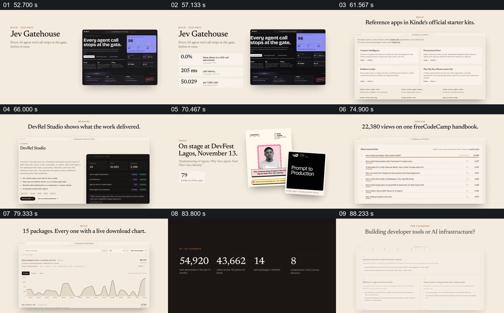

# 用项目页面、活动材料和数据分别支撑不同工作能力

- 作品：案例 034《网页、手机与作品履历》（库内索引名称）。
- 原片范围：00:52.000–01:32.000，含起点、不含终点；[完整原片](../video.mp4)｜[本卡片段](c03.mp4)。
- 范围依据：从特色项目与指标开始，覆盖构建、衡量、教学和写作证据，到整体数据与合作方向；之后转入网址收尾。
- 观察方式与未确认范围：查看整片 64 帧总览和本卡分镜。未独立完成连续原速观看与听审；抽帧之间的运动、停顿与声音配合待复核。画面中的界面、数字与说明是作品呈现，未经额外核实；设计价值为基于画面的分析。

## 原画面具体怎样设计

米白背景上，左侧介绍 Jev Gatehouse 项目，右侧放深色产品页面，接着左侧增加错误率、延迟与成本等指标。随后浏览器页面列出参考应用；再出现工作室介绍与深色数据面板，让成果指标与项目内容同框。

演讲部分以日期与主题为大标题，右侧叠放活动海报和讲座卡；文章部分展示阅读量标题以及带具体文章名称的列表；包管理部分展示多个项目名称和下载曲线。最后黑底并列四组统计数字，再回到浅色页面列出面向创始人的合作事项。不同证明各有对应载体，页面、海报与图表没有被当成同一种素材。

## 为什么这样设计，好在哪里

每项能力后面紧跟与之匹配的证据：产品用项目页和指标，教学用活动材料，写作用文章列表，软件包用下载曲线。黑底汇总把分散的材料收束成可比较的数量，最后再说明这些经验能用于什么合作。开头的工作动词因此在后段获得具体内容。

作品、活动、时间和所有数字只是视频中的主张，未核实真实性、统计范围或时效；图表截图也不自动证明因果。

## 可直接使用的创意指令

先把人物或团队的关键能力分成少数几类，为每类选最能说明问题的实际成果：产品界面、公开文章、活动材料或有口径的数据。画面中让能力说明紧邻对应证据，必要时保留时间、样本和来源；再汇总真正可比的指标，并说明这些经验如何连接当前需求。

可以改变证据顺序、美术和页面样式，但不要用统一的漂亮截图代替具体证明，也不要将未核实的数字包装成事实。

本方法尚未在新题材中实测。
