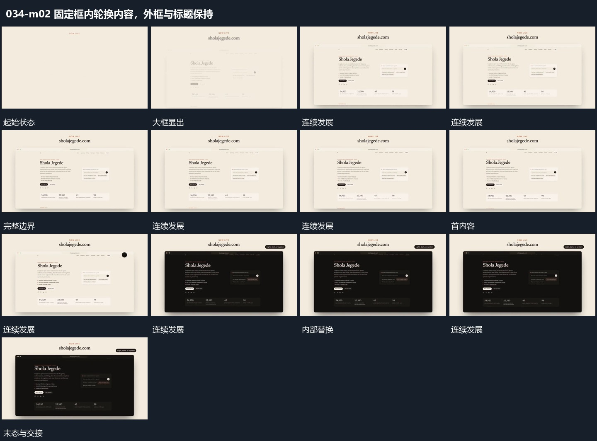

# 固定框内轮换内容，外框与标题保持

## 运动指令

先让大框渐显并完整建立，再显示内部内容。下一状态只在框内接替，边界、位置与上方标题保持，使观者在同一承载区比较不同内部布局。

## 视频切片

[播放本机制的原片切片](m02.mp4)

保留起始准备、连续发展和完成或明确交接；首尾按本段运动范围裁切，不拼接、不变速。尾部只保留理解结果所需的展示。

## 分镜过程

## 组合与调整

替换可按段落发生，不凭少量源帧规定隐藏转场算法。
