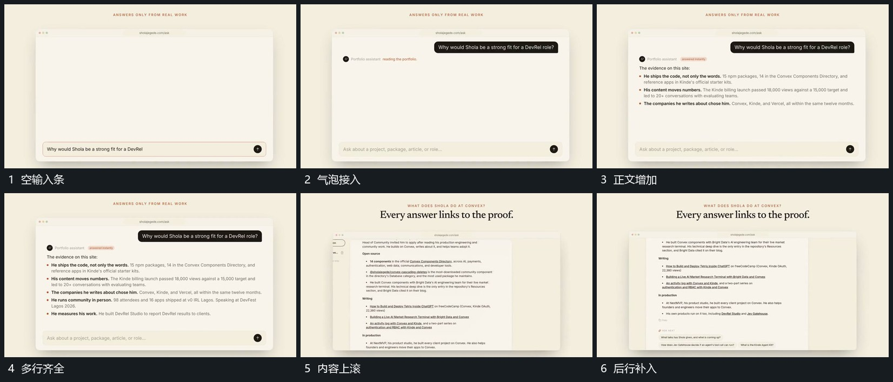

# 上方气泡接到逐行正文，框内上滚继续补行

## 运动指令

在固定大框上方接入气泡和局部小点，随后让正文从上到下逐行补齐。已出现行先保持，内容增多后在框内上滚，把下部空间让给后续行；外框始终不动。

## 视频切片

[播放本机制的原片切片](m04.mp4)

覆盖分镜中“空输入条”至“后行补入”的连续过程，并保留邻近的前后衔接画面；原片中交叠发生的动作一并保留。

## 分镜过程

## 组合与调整

行数可按新材料调整。先建立内容再滚动，不让尚未可读的行立刻退出。
