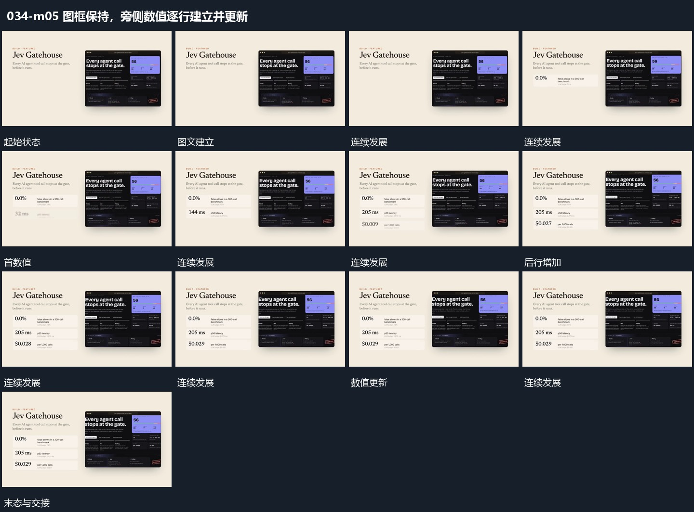

# 图框保持，旁侧数值逐行建立并更新

## 运动指令

保留一侧图框与旁侧字组，先接入一行数值，再逐行补入后续数值。各行出现后更新其数字，图框位置不变；结果齐全后整组减淡，交给下段。

## 视频切片

[播放本机制的原片切片](m05.mp4)

保留起始准备、连续发展和完成或明确交接；首尾按本段运动范围裁切，不拼接、不变速。尾部只保留理解结果所需的展示。

## 分镜过程

## 组合与调整

只描述可见数字变化，不推定统计过程。数值行的出现先后可随本片信息层级调整。
