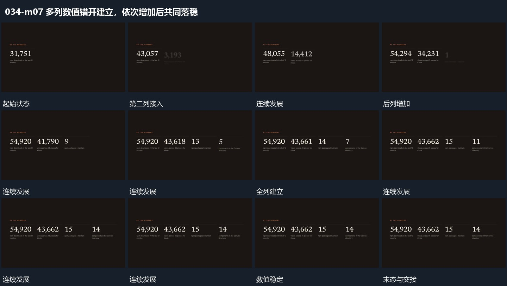

# 多列数值错开建立，依次增加后共同落稳

## 运动指令

先让首列数值增加，再错开启动后续各列；早启动的列可先稳定，后列继续变化。全部到位后在下方补入说明行，结果组整体保持。

## 视频切片

[播放本机制的原片切片](m07.mp4)

保留起始准备、连续发展和完成或明确交接；首尾按本段运动范围裁切，不拼接、不变速。尾部只保留理解结果所需的展示。

## 分镜过程

## 组合与调整

保留启动与停止的错峰，不要求各列同速或同时结束；最终数值由本片材料决定。
