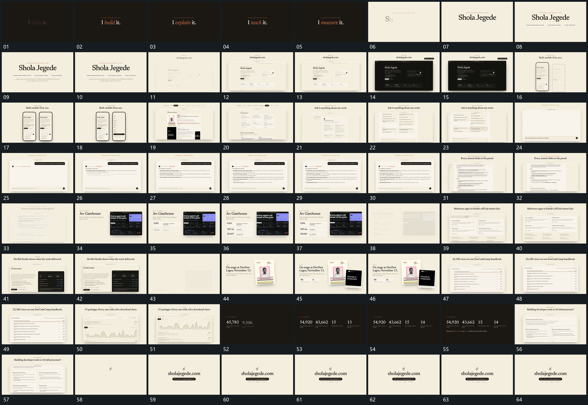

# 034｜原片运动总览

[观看完整原片](video.mp4)

## 运动总览

全片以固定框和字组为持续承载。开头 中央短句原位轮换，局部由模糊变清楚 轮换中央短句并让局部由模糊变清楚；随后 固定框内轮换内容，外框与标题保持 建立大框，内部布局轮换，外部标题保持。两竖框错峰并置，一框内侧边列表展开 依次接入并置竖框，再在其中一个框内展开侧边列表。

中段 上方气泡接到逐行正文，框内上滚继续补行 从上方气泡接续到逐行正文，后续在固定框内上滚补入更多行。图框保持，旁侧数值逐行建立并更新 让旁侧数值从少到多建立并持续更新，图框保持；倾斜前片先进入，后片从侧下补入叠层 将带倾角的片面分层接入，已有片保留。后段又使用 固定框内轮换内容，外框与标题保持 更新大框内容，长内容在固定框内上滚，已有曲线区域随之移入可见区，不是曲线从空开始描出。末段 多列数值错开建立，依次增加后共同落稳 错开建立多列数值并增加到稳定结果，再换框、退净，建立最终短字与长条保持。

## 完整运动段落

以下按原片中的出现顺序引用。建立、内部发展及完成反馈放在同一段中；同时发生的局部动作与运镜写在同一份指令里。不同段之间可以是连续接管，也可以是直接切换，不能仅凭条目相邻认定可直接拼接。重复出现的同类运动采用一次连续代表范围，切片不以逐段无缝覆盖整片为目标。

1. [中央短句原位轮换，局部由模糊变清楚](mechanisms/m01.md)：短句更新，外部小行不动

2. [固定框内轮换内容，外框与标题保持](mechanisms/m02.md)：边界先建立，内部随后接替

3. [两竖框错峰并置，一框内侧边列表展开](mechanisms/m03.md)：第二框先落稳，局部再展开

4. [上方气泡接到逐行正文，框内上滚继续补行](mechanisms/m04.md)：气泡先提示，正文后累积再滚动

5. [图框保持，旁侧数值逐行建立并更新](mechanisms/m05.md)：数值分行补入，图框不随之重排

6. [倾斜前片先进入，后片从侧下补入叠层](mechanisms/m06.md)：先片保持，后片接入

7. [多列数值错开建立，依次增加后共同落稳](mechanisms/m07.md)：前列先开始，后列延迟加入

切片保留起始准备、必要内部停顿和完成或明确交接；首尾省略无新发展的等待，持续运动不要求人为停住。以上基于真实源帧序列和重点边界核对，不等同于全片连续声画审片。

## 完整64宫格

