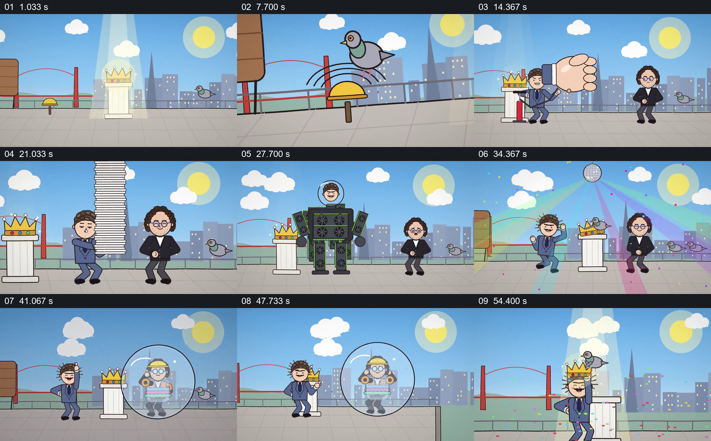

# 围绕固定皇冠展开连串夸张对抗，最后分出胜负

- 作品：案例 070《皇冠争夺的卡通对抗》（本次概括）。
- 原片范围：00:00.000–01:00.053，含起点、不含终点；[完整原片](../video.mp4)｜[本卡片段](../video.mp4)。
- 观察方式：依据约每秒一次的真实源帧观察，未连续原速观看或听审；声音、语气与完整播放节奏未确认。

## 原画面具体怎样设计

城市天际线前的台座上放着皇冠，两名人物在两侧出现，特写交代对视后共同伸手争抢。场地和皇冠反复保留，两人以巨拳、成堆纸张、机器人装置等轮番干扰对方；纸张散开，机器人也散成零件。后段一个人物换上装备并被透明球包住，空间切到桥与海面，球离开场地；留在原处的人取下皇冠戴上，鸽子落到皇冠上，最后切到球中人物在海上漂浮。

## 为什么这样设计，好在哪里

持续可见的皇冠让每轮夸张变化都有共同目标，固定场地与两人反应帮助观众判断对抗双方；结尾分别呈现获胜和离场，把多个道具段落收成同一事件。具体动作间的时间和声音效果仍需连续观看确认。

以上为依据画面的分析，非作者自述；预期观看效果未经观众测试。

## 可直接使用的创意指令

设计一段喜剧竞争时，先让争夺对象、双方位置与目标清楚可见；让每次新道具改变双方的处境，同时保留共同目标和对手反应作为连续线索。逐轮升级后分别交代双方结果，避免只罗列彼此无关的笑点；人物、道具和场景可随新故事调整。
