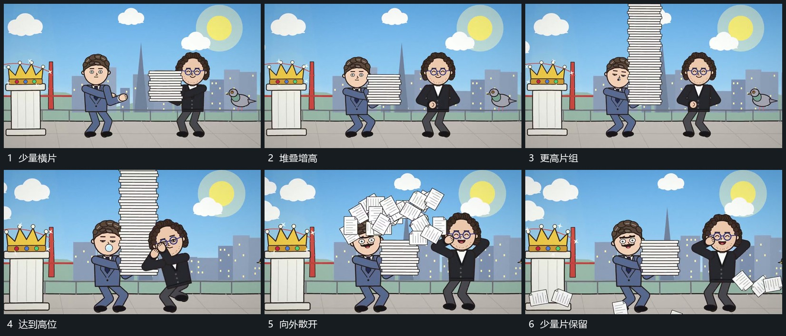

# 横片逐层堆高，到顶后向外散开，保留少量片

## 运动指令

在中部逐层增加横片，已有层保持，片堆向上增高。到顶后向外散开，散片带不同方向和倾角退出，保留少量横片接后续动作。

## 视频切片

[播放本机制的原片切片](m03.mp4)

覆盖分镜中“少量横片”至“少量片保留”的连续过程，并保留邻近的前后衔接画面；原片中交叠发生的动作一并保留。

## 分镜过程

## 组合与调整

不需要原纸张材料，横片可以是任意可堆叠平面。
