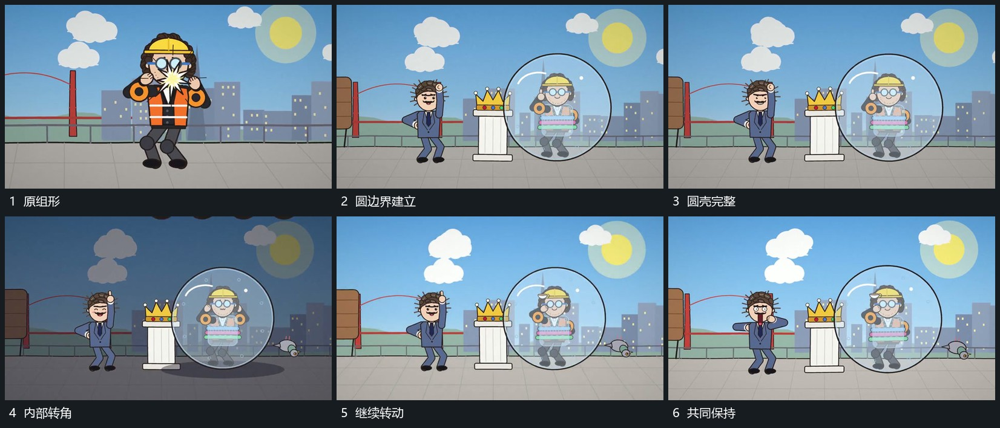

# 圆形边界逐段包住组形，圆壳与内部小幅转动

## 运动指令

在原组形周边逐段建立圆形边界，包住已有组。圆壳完整后内部与壳体共同小幅转动，旁小点继续经过，边界始终保留内部来源。

## 视频切片

[播放本机制的原片切片](m05.mp4)

覆盖分镜中“原组形”至“共同保持”的连续过程，并保留邻近的前后衔接画面；原片中交叠发生的动作一并保留。

## 分镜过程

## 组合与调整

内部主形可换，不推定真实透明球材质。
