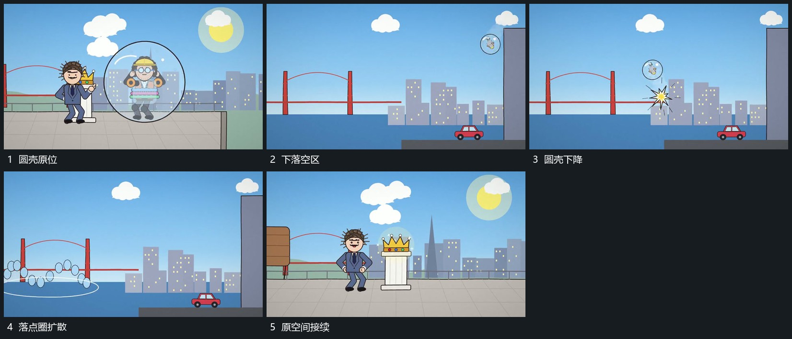

# 圆壳沿弧向下落，落点圈扩散后原空间接续

## 运动指令

让圆壳带着内部组形沿弧向下落，到达下部落点后接入扩散圈，圈向外延长再退去。原空间中的其他组形保持来源位置，随后接上新附属形。

## 视频切片

[播放本机制的原片切片](m06.mp4)

覆盖分镜中“圆壳原位”至“原空间接续”的连续过程，并保留邻近的前后衔接画面；原片中交叠发生的动作一并保留。

## 分镜过程

## 组合与调整

落点反馈要跟实际路径终点一致，不在下落途中提前完成。
