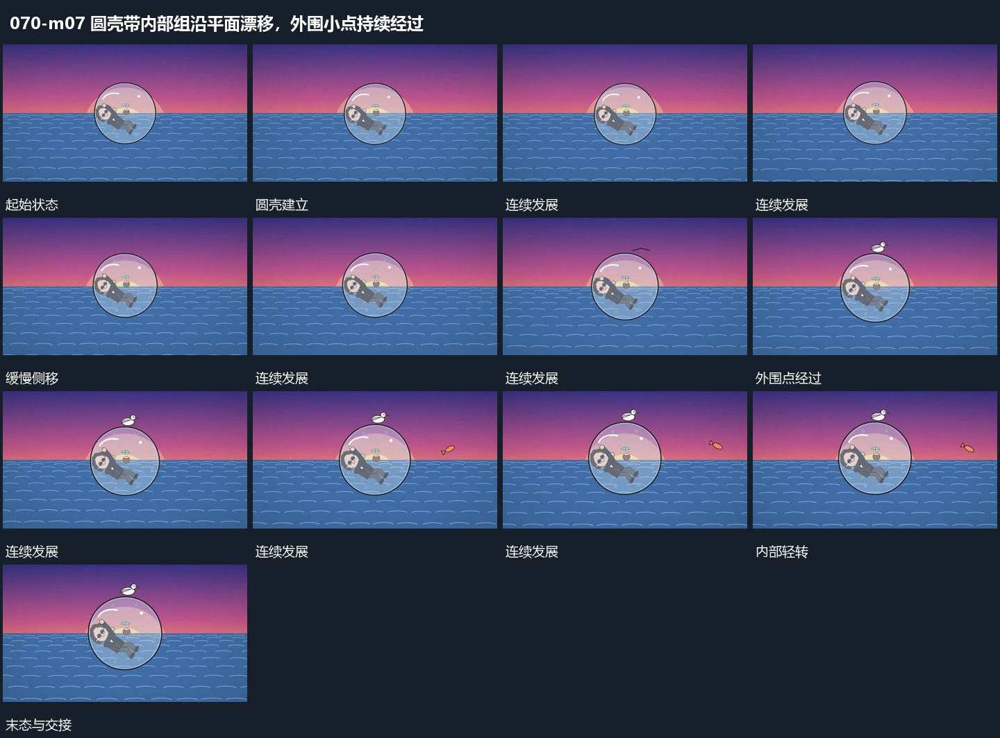

# 圆壳带内部组沿平面漂移，外围小点持续经过

## 运动指令

让圆壳带着内部组沿平面缓慢漂移，内部姿态只轻微改变，壳体边界保持。外围小点从不同侧边经过，形成稳定承载与轻活动，最后整组退暗。

## 视频切片

[播放本机制的原片切片](m07.mp4)

覆盖分镜中“圆壳建立”至“继续漂移”的连续过程，并保留邻近的前后衔接画面；原片中交叠发生的动作一并保留。

## 分镜过程

## 组合与调整

适合接在较强运动之后作为释放，不把所有层都持续快速移动。
