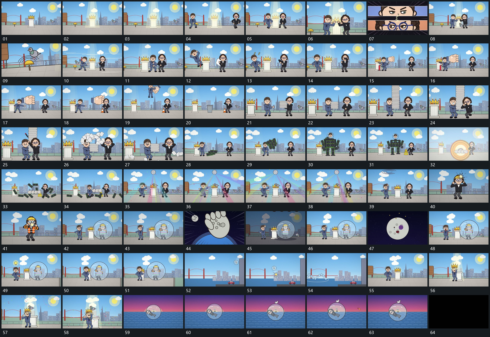

# 070｜原片运动总览

[观看完整原片](video.mp4)

## 运动总览

开头固定空间内两组形从侧边进入，局部接近后 两条窄横片并置局部近景，短线隔开后回到全貌 以两条窄横片并置近景，短线隔开，再回到全貌。局部长形放大后侧向扫过，原组形让位 让局部长形从较小尺度放大并侧向扫过，组形随后上移或退开。

中段 横片逐层堆高，到顶后向外散开，保留少量片 将横片逐层堆高，到顶后向外散开，保留少量片。散块围主形聚成外层，再分解落到承载面 让散块聚到主形周围构成外层，再从局部开始分解，散块落到承载面。圆形边界逐段包住组形，圆壳与内部小幅转动 在主形外逐段补出圆形边界，内部组形随圆壳小幅转动，旁小点经过。

后段 圆壳沿弧向下落，落点圈扩散后原空间接续 圆壳沿弧向下落，落点圈扩散，原空间接续。主形与附属小片接入，短散片向外经过。末段 圆壳带内部组沿平面漂移，外围小点持续经过 圆壳与内部组共同沿平面缓慢漂移，圈内局部姿态轻微改变，外围小点经过，最后退暗。

## 完整运动段落

以下按原片中的出现顺序引用。建立、内部发展及完成反馈放在同一段中；同时发生的局部动作与运镜写在同一份指令里。不同段之间可以是连续接管，也可以是直接切换，不能仅凭条目相邻认定可直接拼接。重复出现的同类运动采用一次连续代表范围，切片不以逐段无缝覆盖整片为目标。

1. [两条窄横片并置局部近景，短线隔开后回到全貌](mechanisms/m01.md)：局部先裁入，再整体接回

2. [局部长形放大后侧向扫过，原组形让位](mechanisms/m02.md)：放大先发生，侧移随后接上

3. [横片逐层堆高，到顶后向外散开，保留少量片](mechanisms/m03.md)：逐层增加后整体释放

4. [散块围主形聚成外层，再分解落到承载面](mechanisms/m04.md)：先聚合，后局部拆散

5. [圆形边界逐段包住组形，圆壳与内部小幅转动](mechanisms/m05.md)：边界先建立，整体随后转动

6. [圆壳沿弧向下落，落点圈扩散后原空间接续](mechanisms/m06.md)：下落先发生，落点圈后扩散

7. [圆壳带内部组沿平面漂移，外围小点持续经过](mechanisms/m07.md)：整体缓慢侧移，内部轻微变化

切片保留起始准备、必要内部停顿和完成或明确交接；首尾省略无新发展的等待，持续运动不要求人为停住。以上基于真实源帧序列和重点边界核对，不等同于全片连续声画审片。

## 完整64宫格

