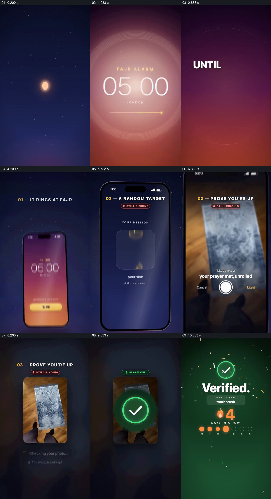

# 让闹钟持续状态连接任务、拍照和验证

- 作品：案例 032《晨间闹钟与拍照验证》（索引名称）。
- 原片范围：00:00.000–00:12.000，含起点、不含终点；[完整原片](../video.mp4)｜[本卡片段](c01.mp4)。
- 观察方式：依据整片 64 宫格和约每秒一次的真实源帧观察，未连续原速观看或听审；声音、语气与完整播放节奏未确认。

## 原画面具体怎样设计

竖屏深蓝背景出现晨间闹钟时间与“IT WON’T…”等提示；手机画面依次显示闹钟仍在响、随机目标为展开祈祷垫。随后第一人称视角对准地上的垫子拍照，界面提示正在检查，画面转为绿色“Verified.”及连续天数。

## 为什么这样设计，好在哪里

把抽象的“起床”变成一个可见任务，再将提交与验证放在同一顺序里，观众能理解提示如何转化为动作。画面仅为产品演示，不能证明识别准确性或照片处理方式。

以上为依据画面的分析，非作者自述；预期观看效果未经观众测试。

## 可直接使用的创意指令

当演示提醒与任务验证的关系时，先说明提醒何时触发，再给一个实际可完成的目标，展示用户提交证据和系统返回的真实状态；对误判、替代操作与照片用途按实际产品能力说明。目标内容和视觉形式可适配使用情境。
