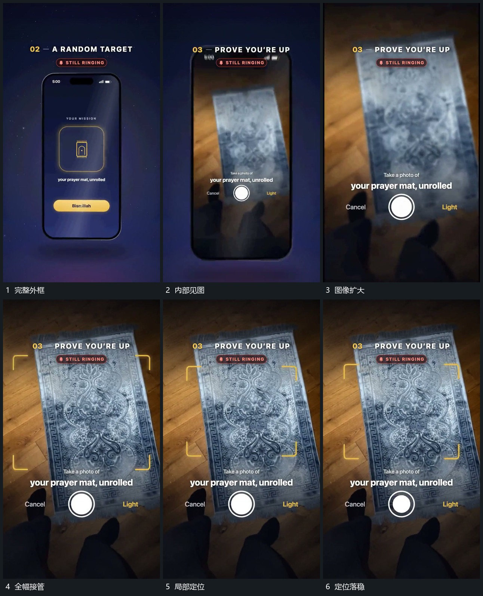

# 框内画面向外扩张，越过边界成为全幅

## 运动指令

先在完整竖框中显示新图像，然后让同一图像的可见范围扩大，越过原框四边接管全幅。外框不再限制图像，上方短条与下方圆形仍可见；全幅稳定后，角形标记接入局部位置。

## 视频切片

[播放本机制的原片切片](m04.mp4)

覆盖分镜中“完整外框”至“定位落稳”的连续过程，并保留邻近的前后衔接画面；原片中交叠发生的动作一并保留。

## 分镜过程

## 组合与调整

可以改扩张中心，但应保留框内与全幅之间可追踪的图像特征。后续缩回时沿同一内容承接，不用不相关满幅素材代替中间过程。
