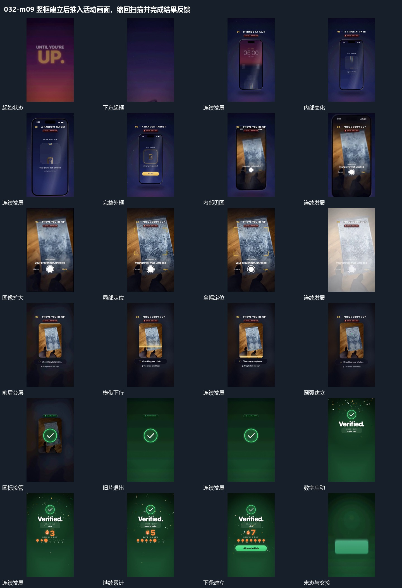

# 竖框建立后推入活动画面，缩回扫描并完成结果反馈

## 运动指令

竖框升入转正，内部轮换后活动画面扩满；再缩回固定竖片接受扫描，完成圆标接管并补齐数值、点列和结果条。

1. **竖框上升转正，推近内部轮换后缩回**

让竖框从下方带倾角上升，逐渐转正落位。框内先建立局部提示，随后推近，使中部小图形成为主要可见内容；这些小图形沿竖向模糊轮换，最后一项停清楚。待边界与下方附属条显出后，整框缩回到可以看清外轮廓的尺度。

2. **框内画面向外扩张，越过边界成为全幅**

先在完整竖框中显示新图像，然后让同一图像的可见范围扩大，越过原框四边接管全幅。外框不再限制图像，上方短条与下方圆形仍可见；全幅稳定后，角形标记接入局部位置。

3. **全幅内容缩回中央竖片，外围底层退虚**

在全幅内容上用短闪衔接，然后将同一内容收拢为中央竖片。中央片面保持清楚，外围原本占满画面的部分退成模糊底层；收拢完成后，中央片成为下一次内部扫描的承载范围。

4. **横带向下扫描，结果圆标放大接管再上移**

让横带从竖片上方向下经过，已扫过区域留在片内，末端叠入局部边框。随后建立小弧形，再扩成完整结果圆标并放大；旧图像与片面退去，圆标留在新底层。圆标缩小并向上移，为下方新内容腾出位置。

5. **数字累加与点列点亮并行，落稳后补入长条**

在上方标记保持的同时，让下方数值连续增加，点列逐项点亮。数值变化期间，周围小片分散落下，不取代数值的位置；累计接近结果后，让数字与点列停稳，再建立底部胶囊形长条。

整段结束：数字停止变化，点列亮起，底部胶囊长条保留。 保留必要落稳与交接，中间已建立的参照沿用到下一步骤。

## 视频切片

[播放本机制的原片切片](m09.mp4)

保留起始准备、连续发展和完成或明确交接；首尾按本段运动范围裁切，不拼接、不变速。相连的小动作合为同一完整段落。

## 分镜过程

## 组合与调整

竖框升入转正，内部轮换后活动画面扩满；再缩回固定竖片接受扫描，完成圆标接管并补齐数值、点列和结果条。 复用时可调整元素数量、幅度和相对节奏，保留上述进入、交叠与完成关系；不直接沿用原片题材或时长。

局部轮换可换成图片或符号，但需保留停清楚的结果。后续可从框内内容向全屏扩张；不要在推近时换掉外框的位置关系，使返回没有参照。

可以改扩张中心，但应保留框内与全幅之间可追踪的图像特征。后续缩回时沿同一内容承接，不用不相关满幅素材代替中间过程。

可调片面尺寸与外围保留比例，必须让收缩的结果能承接下一动作。不要把外围简单清空又另加无关底图，否则会丢掉由全幅缩回的关系。

扫描方向可改，结果标记也可换形，但结果应在扫描推进后出现。圆标的收小上移是下一布局的接点，不另造一个无来源的小标记。

可调整累计幅度和点列数量；若表示真实数量，须另核对应关系。此处借鉴的是并行推进到共同收势，下一场可从上标或底部长条继续。
