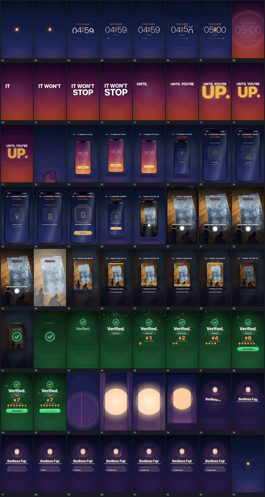

# 032｜原片运动总览

[观看完整原片](video.mp4)

## 运动总览

开头 数字与横向点位接力，短闪后交给字组 用点位和数字形成短促推进，短闪后交给 文字逐组建立，旧行上移退去，新重点放大接上 的文字接力。重点大字落稳后，竖框上升转正，推近内部轮换后缩回 从下方建立竖框，转正、推近内部轮换，再缩回全框。

接下来 框内画面向外扩张，越过边界成为全幅 让框内图像越过边界接管全幅，角形定位稳定后，全幅内容缩回中央竖片，外围底层退虚 又将它缩成中央竖片。两段共享可辨认的内容，扩大和缩回各自可独立取用。片面稳定后 横带向下扫描，结果圆标放大接管再上移 向下扫描，结果圆标接管、上移，接 数字累加与点列点亮并行，落稳后补入长条 的数字与点列累计。

最后旧组退出，中心图形展开后缩成小块，附属文字逐层接入 让细长形展开、缩成小块，标题与逐字长条围绕它建立，再回到小点底层收尾。原片的短闪、文字分组和小图形强调在多处复用。

## 完整运动段落

以下按原片中的出现顺序引用。建立、内部发展及完成反馈放在同一段中；同时发生的局部动作与运镜写在同一份指令里。不同段之间可以是连续接管，也可以是直接切换，不能仅凭条目相邻认定可直接拼接。重复出现的同类运动采用一次连续代表范围，切片不以逐段无缝覆盖整片为目标。

1. [数字与横向点位接力，短闪后交给字组](mechanisms/m01.md)：小点收小后数字建立，底部点位横移伴随数字更换，短闪遮住交接。

2. [文字逐组建立，旧行上移退去，新重点放大接上](mechanisms/m02.md)：已有文字先累积再退让，下方新重点在原组退出后接管。

3. [竖框建立后推入活动画面，缩回扫描并完成结果反馈](mechanisms/m09.md)：竖框升入转正，内部轮换后活动画面扩满；再缩回固定竖片接受扫描，完成圆标接管并补齐数值、点列和结果条。

4. [中心图形展开后缩成小块，附属文字逐层接入](mechanisms/m08.md)：先建立大形再缩成锚点，附属文字围绕已落位的小块出现。

切片保留起始准备、必要内部停顿和完成或明确交接；首尾省略无新发展的等待，持续运动不要求人为停住。以上基于真实源帧序列和重点边界核对，不等同于全片连续声画审片。

## 完整64宫格

